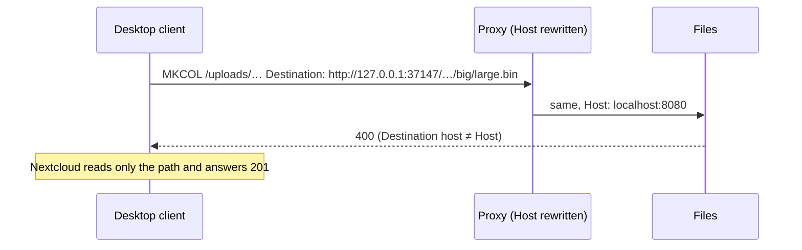

# Proposal: read only the path of a WebDAV Destination, as Nextcloud does

## Finding

The first-article sync journey runs the Nextcloud desktop client through a recording proxy. The proxy rewrites
`Host` to the server's own address and passes `Destination` through unchanged. Nextcloud passes every step. Files
fails the chunked-upload step and, as a knock-on, the rename step.

Nextcloud (Sabre) resolves a Destination by its path alone. Files' `dav.destination` also requires the host to
equal `Host`, and its test asserts that "another host is refused". The same gap appears behind any reverse proxy
that rewrites `Host` without forwarding the original.

## Change

`dav.destination` keeps every path check (the base, `anabel` is not under `ana`, decoding) and stops comparing
hosts. The assertion `another host is refused` becomes `another host's URL resolves by its path, as in Nextcloud`.

## Why this needs a person

It changes an existing test's expectation, and agents never weaken a test. A Destination can only name a path on
the same server for the same user, so reading the path alone gives a client no reach it lacks today.

## Effect

The first-article sync journey reaches parity with Nextcloud on all steps.
