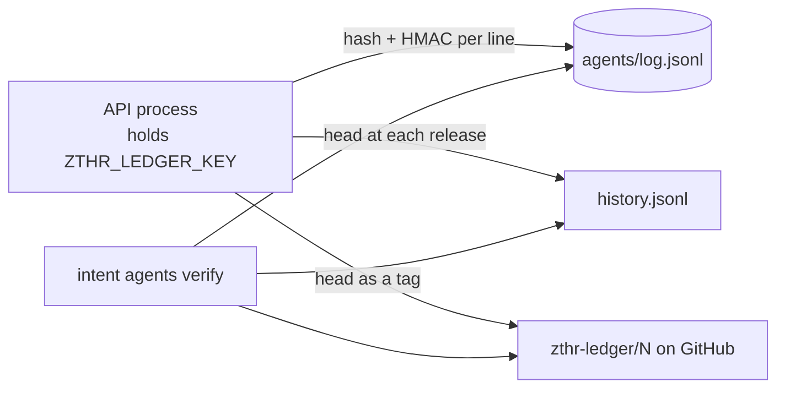

# Proposal: the ledger writer's key, and where its heads are published

**For the owner to set up.** No key has been made and nothing in Google Cloud has been touched.

## What it does

The agents' log (`agents/log.jsonl` in each intent workspace) is a hash chain, and each line now also carries an HMAC made with a key only the ledger writer holds. Someone who can write the file but not read the key can no longer edit a line and recompute the chain, and lines cut off the end are caught against the heads published elsewhere:

| Anchor | Written by | Kept from being moved by |
| --- | --- | --- |
| `ledger: { seq, hash }` in each release record (`history.jsonl`) | every `release_issue`, and every clarification the factory issues | the release packages it sits beside |
| tag `zthr-ledger/<seq>` in the factory repository | `intent agents anchor --workspace ws --factory checkout` | `ruleset-anchors.json` (no update, no deletion) |

`intent agents verify --workspace ws --factory checkout` checks the chain, every HMAC, and every anchor, and fails without the key.



## Steps, in Cloud Shell

```sh
# Once: a 32-byte key in Secret Manager.
openssl rand -hex 32 | gcloud secrets create zthr-ledger-key --data-file=- --replication-policy=automatic

# Each session that runs the agent API (serve, call, drive): the writer holds the key in its environment only.
export ZTHR_LEDGER_KEY="$(gcloud secrets versions access latest --secret=zthr-ledger-key)"

# After a release, or at the end of a shift: publish the head, then push the tag.
node src/cli.ts agents anchor --workspace ws --factory ../factory
git -C ../factory push origin 'refs/tags/zthr-ledger/*'

# Any time: check the log against its key and every anchor.
node src/cli.ts agents verify --workspace ws --factory ../factory
```

The key must not be readable by the agents' own shells. The builder seat runs a coding agent with a shell (`ZTHR_BUILDER_CMD`); start it without `ZTHR_LEDGER_KEY` in its environment, and do not grant its service account `secretmanager.secretAccessor` on `zthr-ledger-key`.

Logs written before the key was set carry no HMAC and will not verify with it. Start a new workspace, or move the old `agents/log.jsonl` aside as history, when the key is first set.

Lines written after the last anchor can still be cut without trace until the next anchor is published, so anchor at least once per shift.
