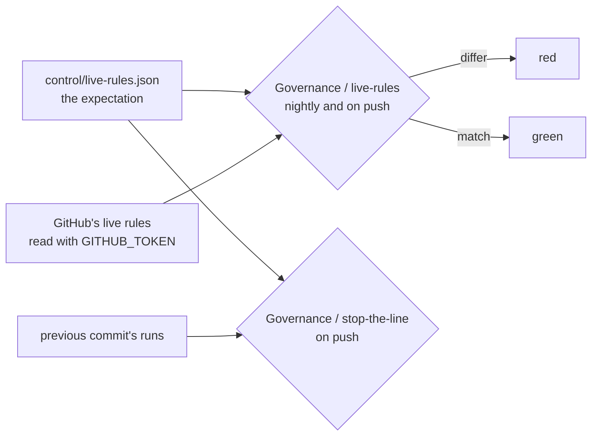

# Proposal: the live rules for main, intent-surface and the anchor tags

**For the owner to decide and apply.** Nothing in GitHub's settings has been changed. This folder holds the expectation the `Governance` workflow compares the live rules with, and the rulesets that would make the live rules match it.

| File | What it is |
| --- | --- |
| `expected.json` | The expectation. Adopted, it becomes `control/live-rules.json` (a person's file). |
| `ruleset-main.json` | `main`: changes arrive by pull request, merged as a merge commit, green on Intent, Files and Supply chain (each pinned to GitHub Actions), never force-pushed or deleted. |
| `ruleset-intent-surface.json` | `intent-surface`: never force-pushed or deleted. Direct pushes are still allowed. |
| `ruleset-anchors.json` | Tags `zthr-ledger/*` (ledger heads) and `zthr-anchor` (the goalposts base): never moved or deleted. |
| `ruleset-anchor-creation.json` | Only a repository admin creates `zthr-anchor`. |



## What each check needs, in order

### 1. Give the required checks the names the ruleset requires

A ruleset requires a check by its check-run name, which is the job's name. Today the Intent and Files jobs are both called `verify` and the Supply chain job `evidence`, so a rule requiring `verify` is met by either workflow, and a rule requiring `Intent` would never be met. One line in each workflow:

| Workflow | Under the job | Add |
| --- | --- | --- |
| `.github/workflows/intent-ci.yml` | `verify:` | `name: Intent` |
| `.github/workflows/files-ci.yml` | `verify:` | `name: Files` |
| `.github/workflows/supply-chain.yml` | `evidence:` | `name: Supply chain` |

Intent and Files run on pull requests only when their paths change. A required check that never runs holds the pull request open for ever, so remove the `paths:` filter from their `pull_request:` triggers (keep it on `push:` if wanted).

### 2. Apply the rulesets

In Cloud Shell or any shell with `gh` signed in as the owner:

```sh
cd ZTHR   # a checkout of russlittle/zthr with this folder in it
for f in ruleset-main ruleset-intent-surface ruleset-anchors ruleset-anchor-creation; do
  gh api -X POST repos/russlittle/zthr/rulesets --input control/proposals/live-rules/$f.json --jq '.id, .name'
done
```

To change one later: `gh api repos/russlittle/zthr/rulesets` lists their ids, and `gh api -X PUT repos/russlittle/zthr/rulesets/<id> --input <file>` replaces one.

### 3. Adopt the expectation

```sh
git mv control/proposals/live-rules/expected.json control/live-rules.json
git commit -S -m "Adopt the live-rules expectation"
```

`control/live-rules.json` is protected by the person-signed check, so this commit must be signed with your key (see `control/proposals/people-keys/`). From then on, `Governance / live-rules` is green only while GitHub enforces exactly what the file says, and it fails nightly if a rule is removed or loosened.

### 4. Optional: make Governance required on main

Add `{ "context": "live-rules", "integration_id": 15368 }`, `{ "context": "stop-the-line", "integration_id": 15368 }` and `{ "context": "person-signed", "integration_id": 15368 }` to `ruleset-main.json`, and the same three to `required_checks` in the expectation, then re-apply both.

## Why each choice

- **Merge commits only on main.** GitHub signs squash and rebase merges with its own GPG key, which replaces your SSH-signed commits. The person-signed check would then refuse every protected change that reached main through a pull request. A merge commit keeps your signed commits, and the check passes a merge whose protected files match one of its parents.
- **Checks pinned to GitHub Actions (app 15368).** A required check named only by context is met by any app or token that can post a status named `Intent`. Pinned, only a GitHub Actions run satisfies it.
- **No approving review required.** With one maintainer, a required approval could never be given. The pull request is still required, so every change to main runs the required checks first.
- **No bypass actors.** As an admin you can still edit or disable a ruleset; nobody can push past one.
- **Stop the line.** `stop_on` names the checks whose red stops new work: on main the three required checks, on intent-surface Supply chain, the one that runs on push there today. A push after a red commit fails `Governance / stop-the-line` unless a commit in it carries the trailer `Fixes-red: <check>`.
