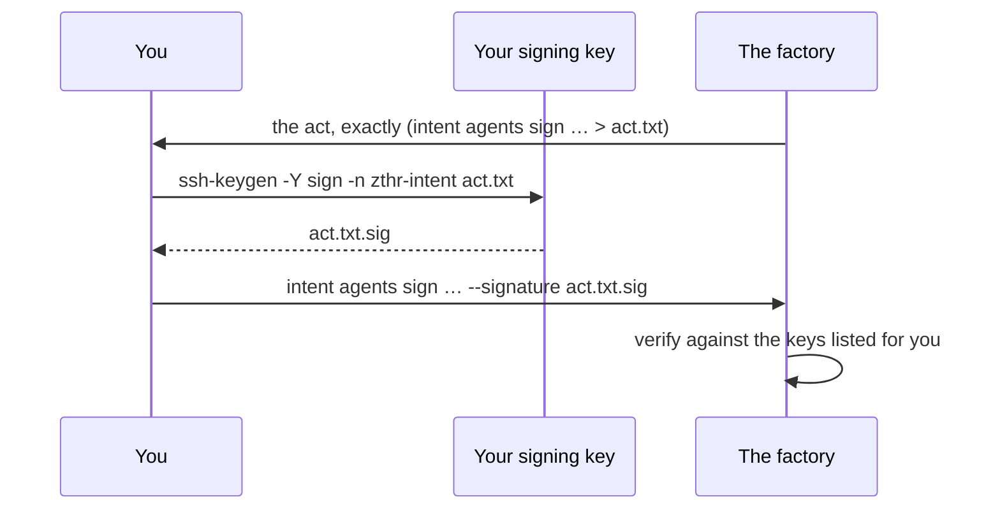

# Proposal: every person-only act is signed with the person's own key

**For the owner to decide and apply.** People files are a person's, so nothing listing who may sign has been changed. This folder proposes the new shape of `control/people.json` and the steps that make the key the only way to act as a person.

## What changes

A listed name is no longer enough. Each act only a person may perform is an SSH signature, by a key listed for that person, over the exact thing decided:

| Act | Where it is checked | What is signed |
| --- | --- | --- |
| A commit touching locked journeys, their lock, people, floors, required checks, or the governance code | `Governance / person-signed` (`intent/tools/goalposts.ts`), against `ZTHR_PERSON_KEYS` | The commit, as git signs it (`gpg.format ssh`) |
| Signing or declining a proposal (answers, journeys, production approval, Class I clarifications) | `intent agents sign` / `decline`, and again every time the decision is read | The proposal's id, the decision, and the SHA-256 of the proposal file |
| The standing delegation and the spending ceiling | `intent agents delegate` / `budget`, and again every time it is read | The values, chained to the previous act so an old one cannot be replayed |

An agent with a shell can still write any file it can reach. What it writes no longer counts: a decision line without a good signature is not a decision, a delegation file is not read, a budget file can only lower the ceiling, and a commit to a protected path without your signature turns the check red.



## Proposed `control/people.json`

`people.json` beside this file: the current list, with a `keys` map from each person to their SSH signing public keys. Ed25519 keys and Ed25519 security keys (`sk-ssh-ed25519@openssh.com`, which must be touched to sign) are accepted. The intent workspace's `agents/people.json` takes the same `keys` map, keyed by the address listed in `signers`:

```json
{ "signers": ["you@example.com"], "keys": { "you@example.com": ["ssh-ed25519 AAAA… you"] } }
```

## Steps

Make the key on a machine agents do not run on. A key in Cloud Shell's home directory can be read by anything that runs as you there, so a security key, or your own computer, is the place for it. OpenSSH on Windows, macOS and Linux all have `ssh-keygen`.

```sh
# 1. The key. With a FIDO2 security key, use -t ed25519-sk instead: each signature then needs a touch.
ssh-keygen -t ed25519 -C "russ zthr signing" -f ~/.ssh/zthr_signing

# 2. Sign your commits with it, and let GitHub show them as verified.
git config --global gpg.format ssh
git config --global user.signingkey ~/.ssh/zthr_signing.pub
git config --global commit.gpgsign true
gh auth refresh -h github.com -s admin:ssh_signing_key
gh ssh-key add ~/.ssh/zthr_signing.pub --type signing --title "ZTHR person signing key"

# 3. The trust root the person-signed check reads. A repository variable is set only by an admin, so a commit
#    cannot add a key to it.
gh variable set ZTHR_PERSON_KEYS --repo russlittle/zthr < ~/.ssh/zthr_signing.pub

# 4. List the key in the people file, in a commit signed with it (on the branch that carries control/).
cp control/proposals/people-keys/people.json control/people.json   # then paste your .pub line in place of REPLACE…
git add control/people.json && git commit -S -m "Sign as a person with my own key"
```

Then, in each intent workspace the agents run in, add the same key to `agents/people.json` under your address.

## The first push of the person-signed rule

The check refuses to pass a push whose base predates it unless every commit in that push is signed by you. So the push that first carries `intent/src/governance/goalposts.ts` is either made of your own signed commits, or `Governance / person-signed` is red on that one push, and green from the next push on, when the base carries the rule. For a scheduled run there is no previous commit; it judges from the `zthr-anchor` tag, which you set once, on a commit you have reviewed:

```sh
git tag zthr-anchor <reviewed commit> && git push origin refs/tags/zthr-anchor
```

## Signing an act in the intent workspace

```sh
node src/cli.ts agents sign p-0123456789 --workspace ws --by you@example.com > act.txt   # refused: prints the act
ssh-keygen -Y sign -n zthr-intent -f ~/.ssh/zthr_signing act.txt
node src/cli.ts agents sign p-0123456789 --workspace ws --by you@example.com --signature act.txt.sig
```

`delegate` and `budget` work the same way.
