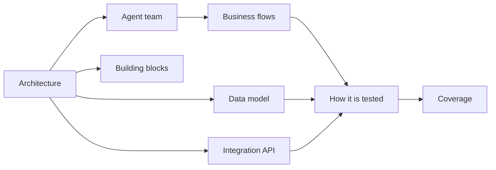

# Documentation

<!-- generated by tools/docs.ts; do not edit by hand -->

## The system

- [The agent team](agents.md)
- [Integration API](api.md)
- [Architecture](architecture.md)
- [Data model](data-model.md)

## Business flows

- [Community](flows/community.md)
- [When something goes wrong](flows/crisis.md)
- [Drafts and approval](flows/drafts-and-approval.md)
- [Money found and short months](flows/money.md)
- [Deadlines, plans and held time](flows/planning.md)
- [Playbooks](flows/playbooks.md)
- [Starting by text](flows/text-onboarding.md)

## How it is tested

- [Running the factory on Google Cloud Build](testing/ci.md)
- [Coverage](testing/coverage.md)
- [Exhaustive walks](testing/exploration.md)
- [Gates](testing/gates.md)
- [Intent journeys](testing/journeys.md)
- [Mutation testing and ratchets](testing/mutation.md)
- [The red team](testing/redteam.md)
- [Walking in a real browser](testing/ui-walk.md)

## Building blocks

- [@zthr/egress](blocks/egress.md)
- [@zthr/evidence](blocks/evidence.md)
- [@zthr/explore](blocks/explore.md)
- [@zthr/gates](blocks/gates.md)
- [@zthr/intent](blocks/intent.md)
- [@zthr/models](blocks/models.md)
- [@zthr/review](blocks/review.md)
- [@zthr/runtime](blocks/runtime.md)
- [@zthr/twins](blocks/twins.md)
- [@zthr/ui](blocks/ui.md)

## Decisions

- [ADR 0001: Storage behind an interface, SQLite first](adr/0001-storage.md)
- [ADR 0002: Hono server and a framework-free progressive web app](adr/0002-web-stack.md)
- [ADR 0003: Deterministic first, models optional](adr/0003-models-offline.md)

Every test file names the document it verifies, and every document lists its tests. The `docs-linked` gate fails
the build when either side is missing.
