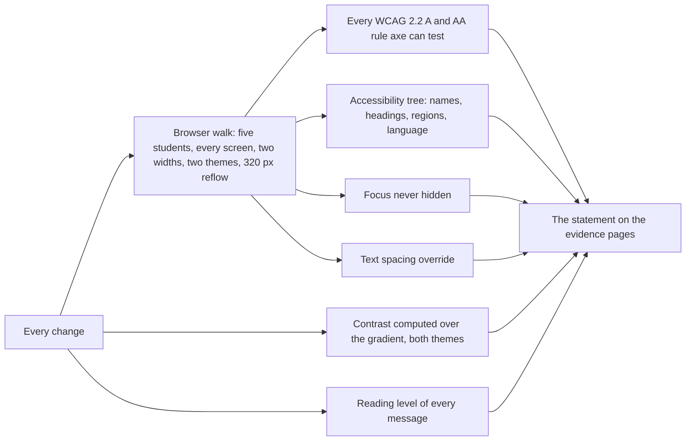

# Accessibility

The Student Advocate is built to meet WCAG 2.2 at level AA and to work with screen readers on phones and computers.
Many of the students it serves read on a small phone, in a second language, with a disability, or late at night
after a shift, so accessibility is part of the product, not a coat of paint.

## How it is built

| Need | What the app does |
| --- | --- |
| Screen readers | Every page has a skip link, a main region, one level-1 heading and headings in order. Every control has a spoken name. Gauges speak their value and the line they are measured against ("2.57 of 4, must reach 2.0"). Tables have captions, and a scrolling table is a named region the keyboard can reach. |
| Status messages | The result of a tap is shown at the top of the next screen as a status message, and the address points straight to it. |
| Keyboard | Everything works with Tab, Enter and Space, with a three-pixel focus ring in every theme. The sticky header and the phone tab bar reserve space, so a focused control is never hidden under them. |
| Low vision | Body text is Atkinson Hyperlegible, a typeface designed for low-vision readers. Text reflows to 320 pixels wide, the width of a 1280-pixel screen at 400% zoom. Every text color is held to 4.5:1 over the strongest part of the background gradient, in both themes. |
| Motor | Buttons and tabs are at least 44 pixels tall; checkboxes at least 24. No action needs dragging. |
| Reading | Messages are written to the reading grade the student sets, eighth grade by default, checked by the tone gate. Students who prefer it get every message by text instead. |
| Motion | No motion that the student did not start; reduced-motion settings turn transitions off. |
| Language | Each page states its language. Spanish replies are marked Spanish so a screen reader uses the right voice. |
| Consistent help | Help, and 988 for a crisis, are in the same place on every screen. |

## How it is tested

Any violation fails the build. The conformance statement on the evidence pages lists every stop of the latest walk
and anything left for a person to review.

## Limits

- **Automated checks only, so far.** They cover what a machine can decide. Testing with NVDA, JAWS, VoiceOver and
  TalkBack, by people who use them every day, is the next step and has not been done yet.
- **Spanish is partial.** It covers starting by text, finding help and crisis replies. The other screens are in
  English, and the gap is on the findings register.

To report a barrier, open an issue in the [discussion forum](https://github.com/russlittle/ZTHR/discussions).
