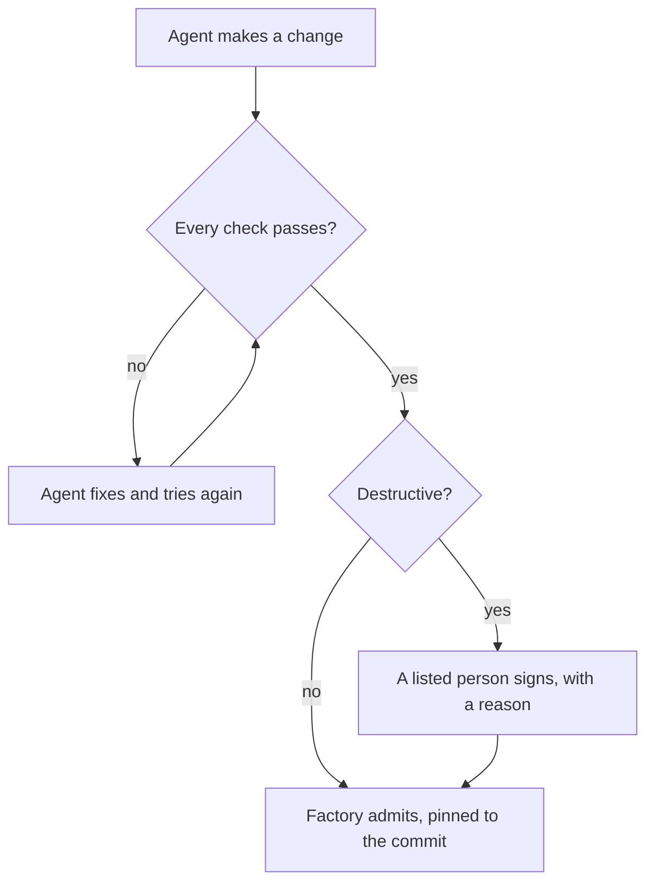

# ADR 0004: The factory admits; people sign only what destroys

## Decision

Agents build. The factory admits a change when every check passes: gates with valid proofs, both walks at their
fixpoint with no violations, every locked journey passing, mutation at or above its floor. Admission is recorded
in the control plane with the commit it was certified at.

A listed person signs only destructive changes:

- loosening or removing a locked journey card;
- lowering a ratchet floor;
- weakening or removing a gate;
- deleting data.

## Why

The intent is stated once, as locked journey cards and declared playbooks. Checks prove each change against that
intent. A person reviewing additive work adds latency without adding proof; a person guarding against loss of a
promise, a floor or data is where judgment matters.

## Consequences

- `npm run certify` admits every builder proposal whose checks all passed, by `factory`.
- `npm run signoff` remains for the person tier and for rejections.
- `npm run lock -- --direction new|tighten` needs no person; `--direction loosen` and removals do.
- Admissions and rejections are appended to `control/admissions.jsonl`.
