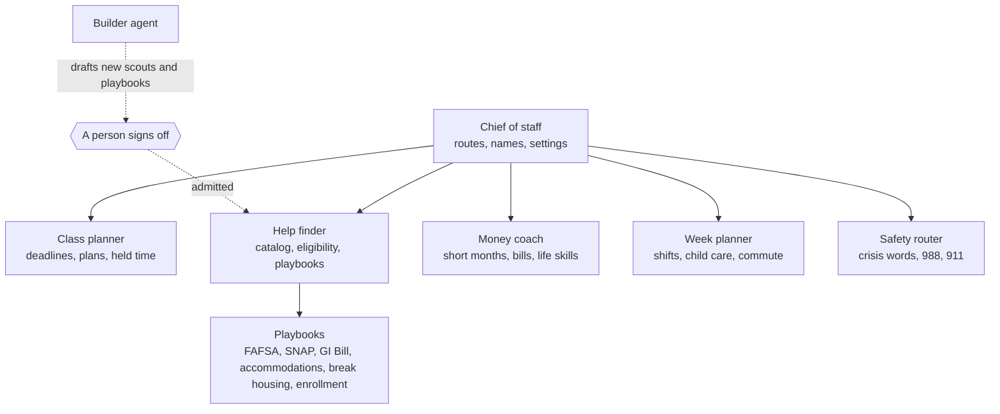
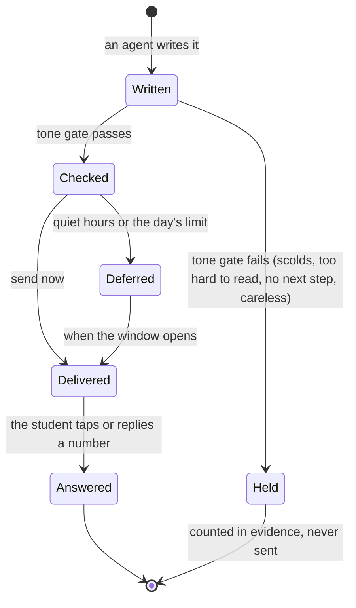

# The agent team

One student, one team, one voice. The chief of staff decides who speaks; every specialist's message goes through
the same delivery path. No agent can send anything on a student's behalf: it can only draft.

## A message's life

Safety messages skip the reading-grade check and the governor; they always go now.

## What each agent may do

| Agent | Reads | Writes | May never |
| --- | --- | --- | --- |
| Chief of staff | profile, settings, last choices | messages, settings | do coursework |
| Class planner | deadlines, classes, shifts, holds | plans, holds, reminders, drafts to instructors | write assignments |
| Help finder | catalog, eligibility, vault names | messages, playbook runs, drafts | ask about citizenship or immigration status |
| Money coach | balance, bills, pay | messages, drafts to landlords and utilities | give legal, tax or investment advice |
| Week planner | classes, shifts, child care | the week, drafts to managers | move anything without asking |
| Safety router | the words of the message | a crisis reply | wait for quiet hours |
| Builder | evidence of unmet needs | proposals | admit its own work |

## Verified by

<!-- verified-by:start -->
- [`apps/advocate/test/advocate.test.ts`](../apps/advocate/test/advocate.test.ts) (7 test definitions)
- [`apps/advocate/test/builder.test.ts`](../apps/advocate/test/builder.test.ts) (10 test definitions)
- [`apps/advocate/test/plain-language.test.ts`](../apps/advocate/test/plain-language.test.ts) (5 test definitions)
<!-- verified-by:end -->
