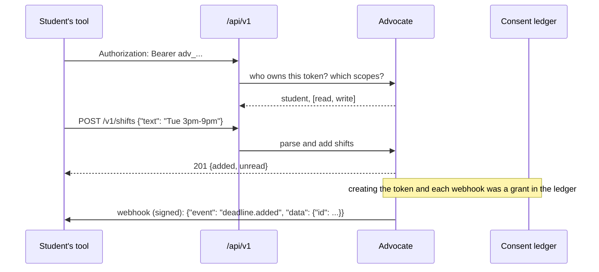

# Integration API

Students connect their own tools to their Advocate. Each request carries a token the student made on the You
screen; it reaches only that student's data, within the scopes they chose. Ingest runs through the same code as the
app, so the same gates check it. Sealed facts are never exported.

<!-- generated:api:start -->
| Method | Path | Scope | What it does |
| --- | --- | --- | --- |
| `GET` | `/api/v1/me` | read | Your profile (never sealed facts) |
| `GET` | `/api/v1/today` | read | Today: classes, shifts, what is due, the one thing |
| `GET` | `/api/v1/deadlines` | read | All deadlines |
| `POST` | `/api/v1/deadlines` | write | Add a deadline |
| `POST` | `/api/v1/syllabus` | write | Ingest a syllabus; dates come back unconfirmed |
| `POST` | `/api/v1/calendar` | write | Ingest an iCalendar feed |
| `GET` | `/api/v1/shifts` | read | Work shifts |
| `POST` | `/api/v1/shifts` | write | Add shifts as text ("Tue 3pm-9pm") or as a list |
| `POST` | `/api/v1/inbound/email` | write | Forward an email; needs forwarding turned on |
| `PUT` | `/api/v1/money` | write | Balance, bills and pay |
| `GET` | `/api/v1/eligibility` | read | Programs checked and results |
| `GET` | `/api/v1/messages` | read | Messages your Advocate sent you |
| `POST` | `/api/v1/actions` | actions | Tap any button by its action id |
| `GET` | `/api/v1/export` | read | Everything, as JSON |
| `GET` | `/api/v1/export/{collection}.csv` | read | One collection as CSV |
| `GET` | `/api/v1/calendar.ics` | read | Deadlines and held time as a calendar feed |
| `GET` | `/api/v1/webhooks` | read | Your webhooks |
| `POST` | `/api/v1/webhooks` | write | Add a webhook (https only) |
| `DELETE` | `/api/v1/webhooks/{id}` | write | Remove a webhook |

The full description is served at `/api/openapi.json`.
<!-- generated:api:end -->

## Verified by

<!-- verified-by:start -->
- [`apps/advocate/test/api.test.ts`](../apps/advocate/test/api.test.ts) (33 test definitions)
<!-- verified-by:end -->
