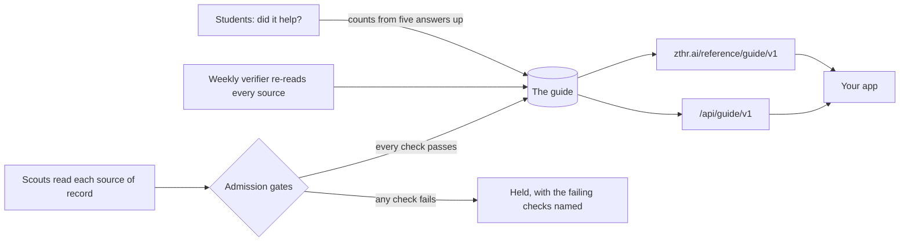
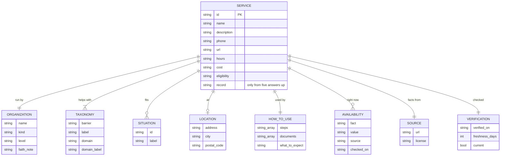

# The guide feed: community resources as open data

The community resource guide is published as a feed that any app can take. A college portal, a library, a congregation, a county help line or another student app can use it directly, with no need to call agencies and check hours itself. The feed is a public good. It lists services and never students. It is free to use under [CC BY 4.0](https://creativecommons.org/licenses/by/4.0/), with attribution.

Each entry carries:

- its source of record;
- the day it was verified and whether it is still current;
- the kind of provider (college, government, nonprofit, faith, community or health), plus whether help from a faith group depends on faith;
- what it costs, what to expect, and how to use it, step by step.

The design behind it is in [the resource guide flow](../flows/resource-guide.md).

## Two ways to take it

| | Where | When to use it |
|---|---|---|
| Live API | `https://advocate-fsy7whk33q-uc.a.run.app/studentadvocate/api/guide/v1/` | When you need filters, or the newest records of whether each entry helped |
| Static files | `https://zthr.ai/reference/guide/v1/` | For a nightly copy. The files are rebuilt with every release and do not depend on a server |

Both answer with the same JSON, built by the same code. The API sends `Access-Control-Allow-Origin: *`, so a browser app can call it directly. Responses may be cached for five minutes.



## Endpoints

| Path | Static file | What it returns |
|---|---|---|
| `/api/guide/v1` | `index.json` | The license and the list of endpoints |
| `/api/guide/v1/services` | `services.json` | Every service. Filters: `barrier`, `county` (`Montgomery` or `Greene`), `kind` (`college`, `government`, `nonprofit`, `faith`, `community`, `health`) |
| `/api/guide/v1/services/{id}` | `services/{id}.json` | One service |
| `/api/guide/v1/barriers` | `barriers.json` | The five domains, the 23 barriers, the situations, and the kinds of provider |
| `/api/guide/v1/packages` | `packages.json` | Support packages: the services that usually work together for one barrier, in the order to try them |
| `/api/guide/v1/coverage` | `coverage.json` | For each barrier and county, how many current services there are and from which kinds of provider, with the gaps named |
| `/api/guide/v1/openapi.json` | `openapi.json` | An OpenAPI 3.1 description of all of the above |

The static files take no filters. Filter `services.json` in your app instead.

## A service

The fields follow the [Open Referral Human Services Data Specification](https://docs.openreferral.org/) (service, organization, location, phone, eligibility, taxonomy), so a tool that reads HSDS needs little mapping. The schema is enforced in code (`apps/advocate/src/guide/feed.ts`): every response is checked against it in the tests.



```json
{
  "id": "daybreak",
  "name": "Daybreak",
  "description": "The Miami Valley's shelter for young people without a safe place to stay, with help finding a place of their own.",
  "organization": { "name": "Daybreak", "kind": "nonprofit", "kind_label": "Nonprofit", "level": "regional" },
  "taxonomy": [
    { "barrier": "emergency", "label": "Emergency", "domain": "feasible", "domain_label": "Making college life work" },
    { "barrier": "housing", "label": "Housing", "domain": "feasible", "domain_label": "Making college life work" }
  ],
  "situations": [{ "id": "youth-under-25", "label": "Young adults under 25" }],
  "serves": { "counties": ["Montgomery", "Greene"], "colleges": [], "national": false },
  "phone": "937-461-1000",
  "hours": "Hotline open 24 hours, every day",
  "cost": "free",
  "how_to_use": { "steps": ["Call the 24-hour hotline, 937-461-1000.", "Tell them where you are staying now and whether you are safe tonight."], "documents": [] },
  "source": { "url": "https://www.daybreakdayton.org/", "license": "public-information" },
  "verification": { "verified_on": "2026-11-13", "freshness_days": 30, "current": true }
}
```

The example is shortened. The full entries are in `services.json`.

## What the feed promises

Every promise below is held by a test or a locked journey, run with every build.

| Promise | Held by |
|---|---|
| No student data, ever: no name, phone, id or answer | `p6-public-feed`, `guide.test.ts` |
| Every entry has a source of record and a verified date | admission gates, `p6-public-feed` |
| An entry past its freshness is marked `current: false`, not hidden, and is not counted in coverage | `guide.test.ts` |
| "Did it help" counts appear only once five or more students have answered, and each student counts once | `p6-did-it-help` |
| An entry that fails any admission gate never reaches the feed | `p6-bad-entry-held`, `guide.test.ts` (one planted bad entry per gate) |
| Every faith-based entry says whether help depends on faith | `p6-public-feed` |
| Every response matches the published schema | `guide.test.ts` |

## Keeping it true

The guide is only useful if it is right, so every entry is kept current by agents under the same rules as the rest of the Advocate:

- **Scouts own entries.** Each entry is owned by one declared scout (`control/scouts/*.yaml`), which names its sources and how often they are re-read. An entry no scout owns is held.
- **Admission gates check each entry.** Before it is admitted, an entry needs:
  - a cited source and a real date;
  - a declared freshness;
  - barriers from the taxonomy;
  - a stated provider and where it serves;
  - a way to reach it, and a phone number that is a phone number;
  - steps for using it;
  - eligibility and steps in plain words;
  - eligibility rules and form fields the Advocate knows;
  - sourced, dated availability facts;
  - an owner;
  - no duplicate.
- **The verifier re-reads every source each week.** It checks that each source and page answers, that the listed phone number still appears there, and that the entry is within its freshness. Whatever it cannot confirm goes to the curator, by entry. The [Guide verification](https://github.com/russlittle/ZTHR/actions/workflows/guide-verify.yml) workflow publishes each run.
- **Students say whether it helped.** Their answers rank entries for other students. An entry tried by ten or more students that helped fewer than a quarter of them is flagged for review. It is never hidden.

## Attribution

Credit the guide with: *Community resource guide, Student Advocate (zthr.ai). Facts from each entry's cited source of record.*

Hours and openings change. Ask your users to call ahead, the way the Advocate asks students to.
