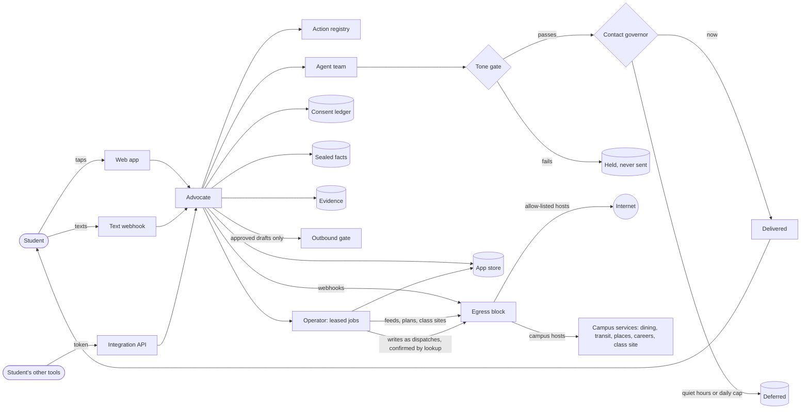
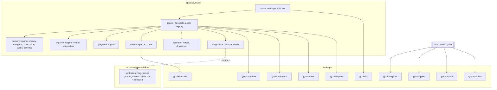
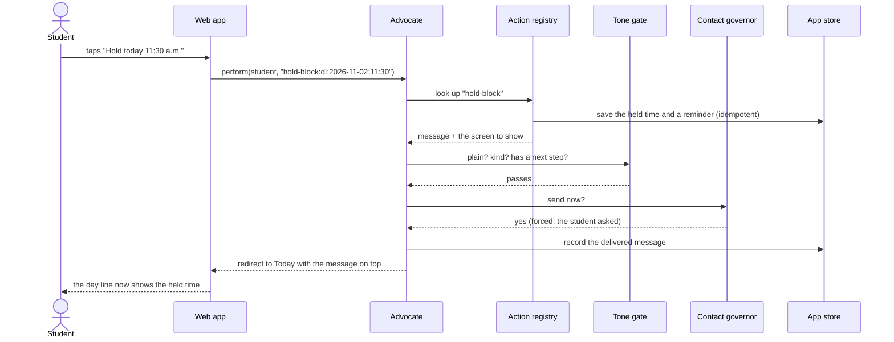
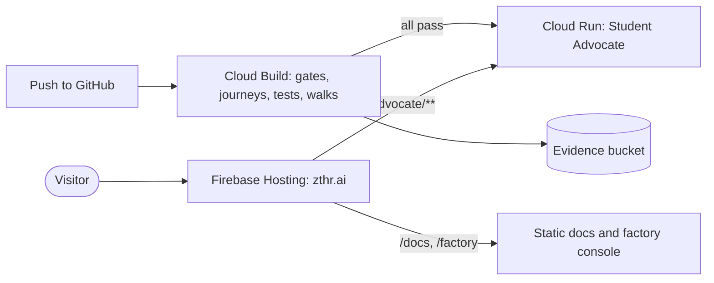

# Architecture

The Student Advocate is one service with three ways in: the web app, text messages and the integration API. All
three call the same Advocate, so a button, a text reply and an API call do exactly the same thing. Everything the
Advocate says passes the tone gate and the contact governor before it reaches a student. Nothing leaves for the
network except through the egress block, and nothing is sent on a student's behalf without their approval.

## System context

The operator is the part that works when no one is asking: it refreshes campus feeds, plans bus trips, syncs class
sites and carries out the writes students asked for, on a schedule and under leases. Conversations never wait on
the network; they answer from what the operator fetched and say how old it is.

## Building blocks

Every box below is a package any app in the factory can reuse. The Advocate is one app built from them.

| Block | What it gives an app |
| --- | --- |
| `@zthr/ui` | Light and dark tokens, app and console shells, notes, day line, week grid, tiles, rows, forms, tables, icons; everything escaped |
| `@zthr/explore` | Exhaustive model-based exploration to a fixpoint, with invariants at every step |
| `@zthr/egress` | The one allow-listed, recorded door to the network, and its twin |
| `@zthr/gates` | Three-valued verdicts, falsification proofs, ratchets, datums, findings |
| `@zthr/evidence` | Append-only, pseudonymous evidence store and measures |
| `@zthr/runtime` | Approval tokens and the outbound gate, contact governor, safety screen, consent ledger, sealed facts, start-up refusal |
| `@zthr/intent` | Locked journey cards and the journey runner |
| `@zthr/twins` | Calibrated stand-ins for outside services |
| `@zthr/models` | Metered, budgeted model client with a twin |
| `@zthr/review` | Optional multi-family model review |

## A tap, end to end

The same action by text is a reply of "1"; by API it is `POST /api/v1/actions`.

## Deployment

## Verified by

<!-- verified-by:start -->
- [`apps/advocate/test/api.test.ts`](../apps/advocate/test/api.test.ts) (33 test definitions)
<!-- verified-by:end -->
