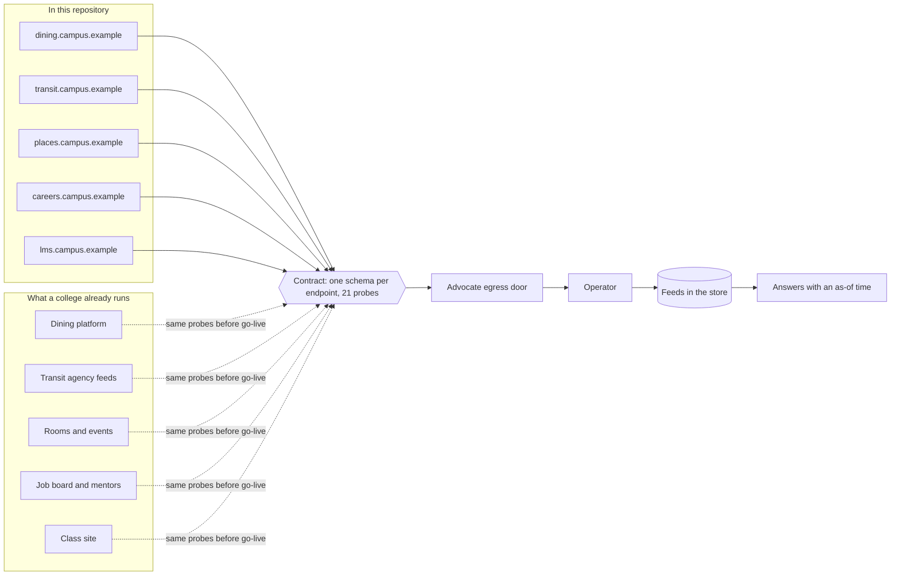
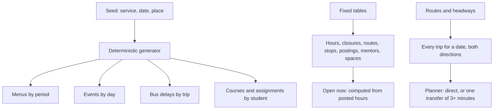
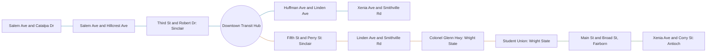

# Campus services

Colleges already run software for dining, buses, rooms and events, jobs and mentors, and classes. The Advocate
reads from those services; it does not replace them. This repository includes a synthetic version of each one: a
real HTTP API with the shape a college's vendor would have, synthetic data that is the same on every run, and a
contract that any real vendor must meet before the Advocate is pointed at it.

## The five services

| Service | Shaped like | Endpoints | Scenarios for testing |
| --- | --- | --- | --- |
| Dining | A campus dining platform | locations, hours by day, menus by period, open now, item search | outage, slow, weather closure |
| Transit | GTFS static and realtime, plus a trip planner | agency, routes, stops, departures, trips, plan with one transfer, arrivals, alerts | outage, slow, snow delays, detour, no service |
| Places | Room booking and an events calendar | spaces, open now, room availability, reservations with idempotency keys, events | outage, slow |
| Careers | A job board and mentor directory | postings with weekly schedules, mentors with open slots | outage, slow |
| Class site | A learning management system's REST API | self, courses, assignments, announcements, calendar events (bearer token) | outage, slow, reschedule |

Every service answers `/healthz` and `/openapi.json`, takes `at` (or the `X-Twin-Clock` header) as its clock, and
takes `X-Twin-Scenario` to act out a bad day. In the demonstration they are public at `/twins/<service>/...`; on
a machine, `npm run campus` runs each on its own port.

## How the data is made

The same request at the same clock always gets the same answer, which is what lets the walks treat these services
like fixtures: the fixture knows what right looks like.

## The transit network

Route 1 (blue) runs every 20 minutes on weekdays, Route 2 (brown) every 30, Route 11 (green) every hour. Route 1 is
the only one on Sundays. No bus runs on Thanksgiving, Christmas or New Year's Day.

## Contract and fixtures

`npm run contract` sends 21 probes to each service and checks two things: the answer meets its schema, and it
matches the fixture recorded from the synthetic service. A synthetic service that drifts from its fixtures fails
before any test can trust it. `npm run contract -- --base transit=https://...` sends the same probes to a real
vendor and checks only the schema.

## Use it for

Standing in for a college's vendors while building and testing: real HTTP, contracts, fixtures and bad-day scenarios.

## Not for

Production data, or anything the Advocate decides; it only answers like a vendor would.

## Verified by

<!-- verified-by:start -->
- [`apps/campus-services/test/services.test.ts`](../../apps/campus-services/test/services.test.ts) (36 test definitions)
<!-- verified-by:end -->
