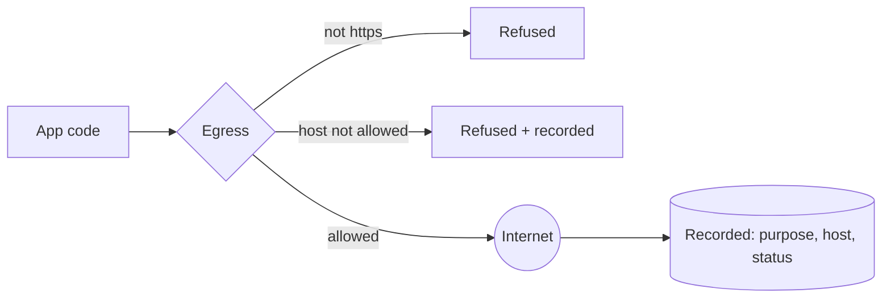

# @zthr/egress

The one door to the network for app code. Requests name a purpose, go only to allow-listed https hosts, never
follow redirects, time out, and are recorded. The twin behaves the same and never leaves the machine. The
`no-hidden-egress` gate fails any other file that reaches the network.

## Verified by

<!-- verified-by:start -->
- [`packages/egress/test/egress.test.ts`](../../packages/egress/test/egress.test.ts) (4 test definitions)
<!-- verified-by:end -->
