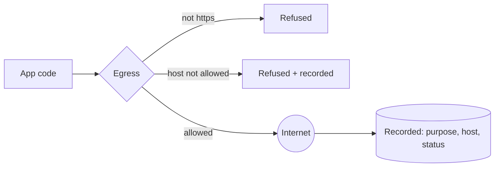

# @zthr/egress

The one door to the network for app code. Requests name a purpose, go only to allow-listed https hosts, never
follow redirects, time out, and are recorded. The twin behaves the same and never leaves the machine. The
`no-hidden-egress` gate fails any other file that reaches the network.

## Use it for

Every network call app code makes: webhooks, the weather service, campus services, sign-in keys. Each names its purpose and goes only to a host the app declared. `routedEgress` runs services in-process behind the same door; `EgressTwin` records without leaving the machine.

## Not for

Model calls (they go through the models block), inbound requests, or retry policy (callers decide; writes use idempotency keys and are verified).

## Verified by

<!-- verified-by:start -->
- [`packages/egress/test/door.test.ts`](../../packages/egress/test/door.test.ts) (8 test definitions)
- [`packages/egress/test/egress.test.ts`](../../packages/egress/test/egress.test.ts) (4 test definitions)
<!-- verified-by:end -->
