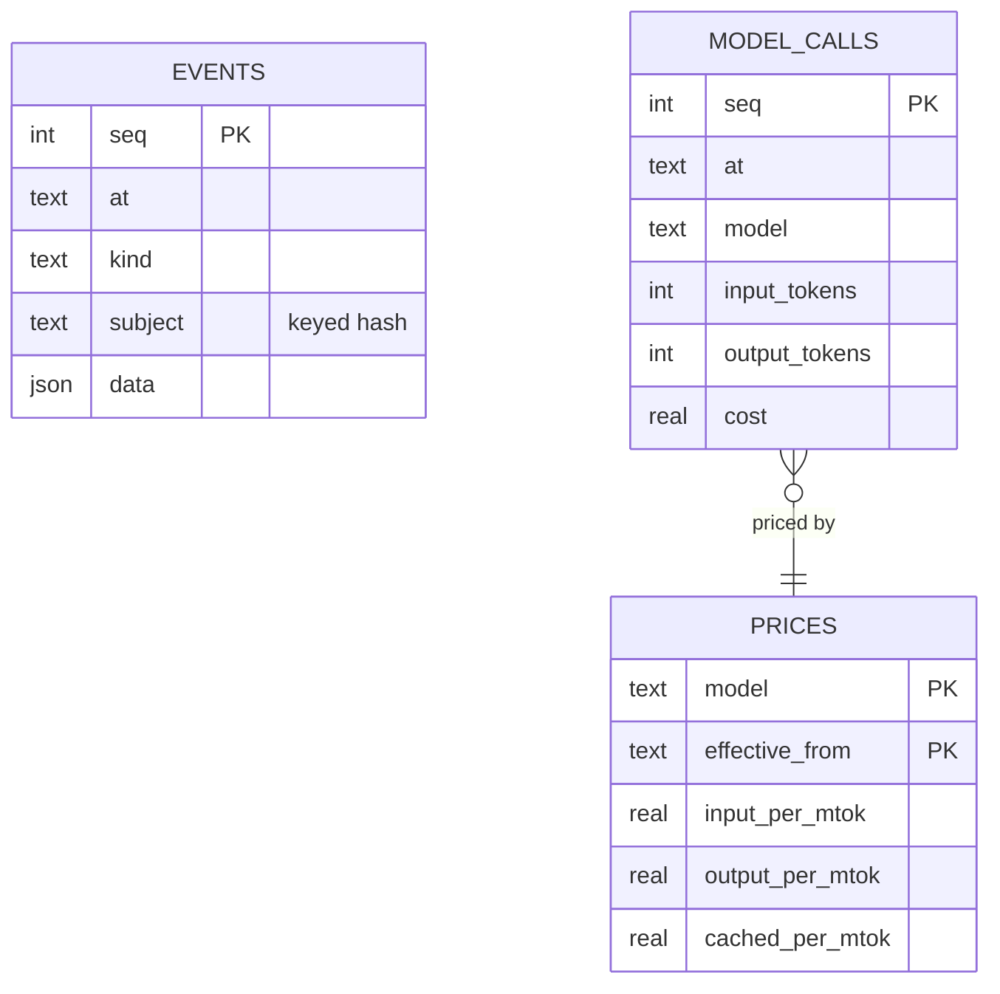

# @zthr/evidence

Append-only, pseudonymous evidence: what the factory and the product did. Subjects are keyed hashes; message
content is never recorded. Measures (intent completion, revision rate, cost as paid and at today's prices,
distributions) are computed from it, and "not measured" is never shown as zero.

## Verified by

<!-- verified-by:start -->
- [`packages/evidence/test/evidence.test.ts`](../../packages/evidence/test/evidence.test.ts) (6 test definitions)
<!-- verified-by:end -->
