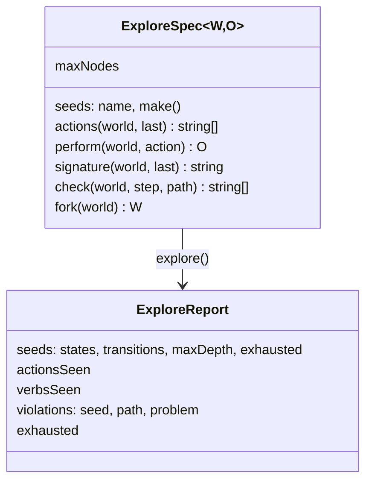

# @zthr/explore

Exhaustive model-based exploration for any interactive system. Give it seeds, how to list and perform actions, a
state signature and invariants; it runs to a fixpoint and reports every violation with the exact path that caused
it. With `fork`, it copies the world at each state instead of replaying paths.

## Use it for

Walking a deterministic model to a fixpoint: every action from every reachable state, with invariants checked on every step and frozen snapshots instead of replays.

## Not for

Systems that talk to the network or depend on the clock mid-walk (feed them fixtures first), load testing, or random fuzzing.

## Verified by

<!-- verified-by:start -->
- [`packages/explore/test/explore.test.ts`](../../packages/explore/test/explore.test.ts) (5 test definitions)
<!-- verified-by:end -->
