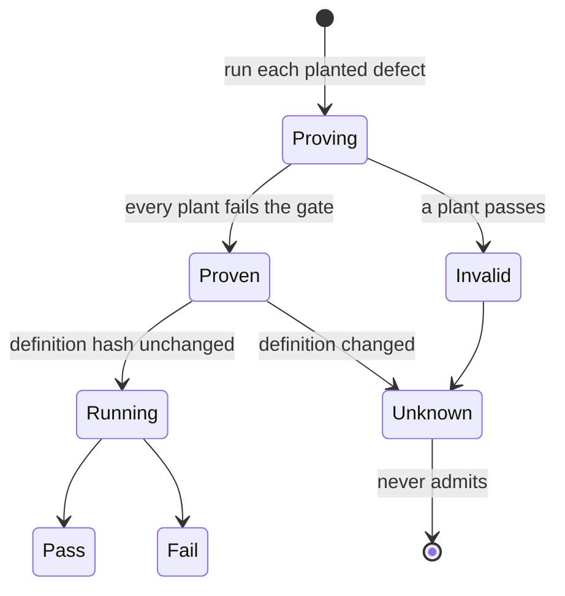

# @zthr/gates

Gates that must prove they can fail before their verdict counts. A gate carries planted defects; its proof is
pinned to a hash of its definition. Change the gate and the proof is stale; a stale proof makes the verdict
unknown, and unknown never admits.

Also here: ratchets (floors that only rise, reset only by listed people in a ledger), datums, and the findings
register.

## Use it for

Named checks that must go red on planted defects before they count, with proofs pinned to their definitions, and ratchets that only tighten.

## Not for

Ordinary unit tests, or any check that has never been seen to fail.

## Verified by

<!-- verified-by:start -->
- [`packages/gates/test/gates.test.ts`](../../packages/gates/test/gates.test.ts) (16 test definitions)
- [`packages/gates/test/hardening.test.ts`](../../packages/gates/test/hardening.test.ts) (6 test definitions)
<!-- verified-by:end -->
