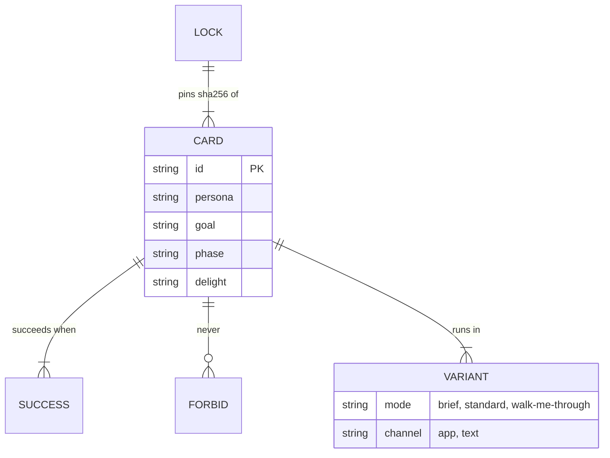

# @zthr/intent

Journey cards and their runner. A card states a persona, a goal, what success looks like, what must never happen,
the modes and channels it covers, and its action and time budgets. Cards are locked by hash.

## Verified by

<!-- verified-by:start -->
- [`packages/intent/test/intent.test.ts`](../../packages/intent/test/intent.test.ts) (6 test definitions)
<!-- verified-by:end -->
