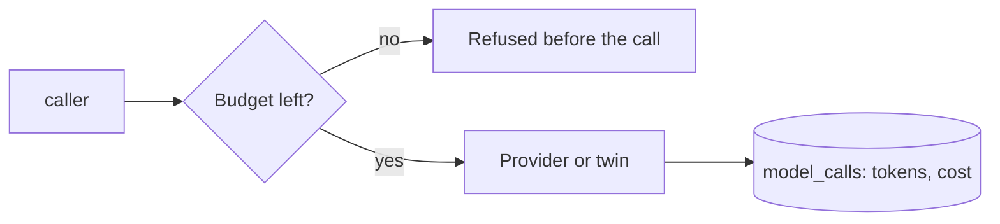

# @zthr/models

A metered, budgeted model client for any OpenAI-compatible provider, and a twin for tests. Every call is priced
and recorded; a budget stops calls before they happen. The Advocate makes no model calls in Phase 1.

## Use it for

The one model client: metered, swappable for a twin, and used only inside a deterministic sandwich.

## Not for

Decisions that must be right every time (use deterministic code), or calling a provider directly.

## Verified by

<!-- verified-by:start -->
- [`packages/models/test/models.test.ts`](../../packages/models/test/models.test.ts) (2 test definitions)
<!-- verified-by:end -->
