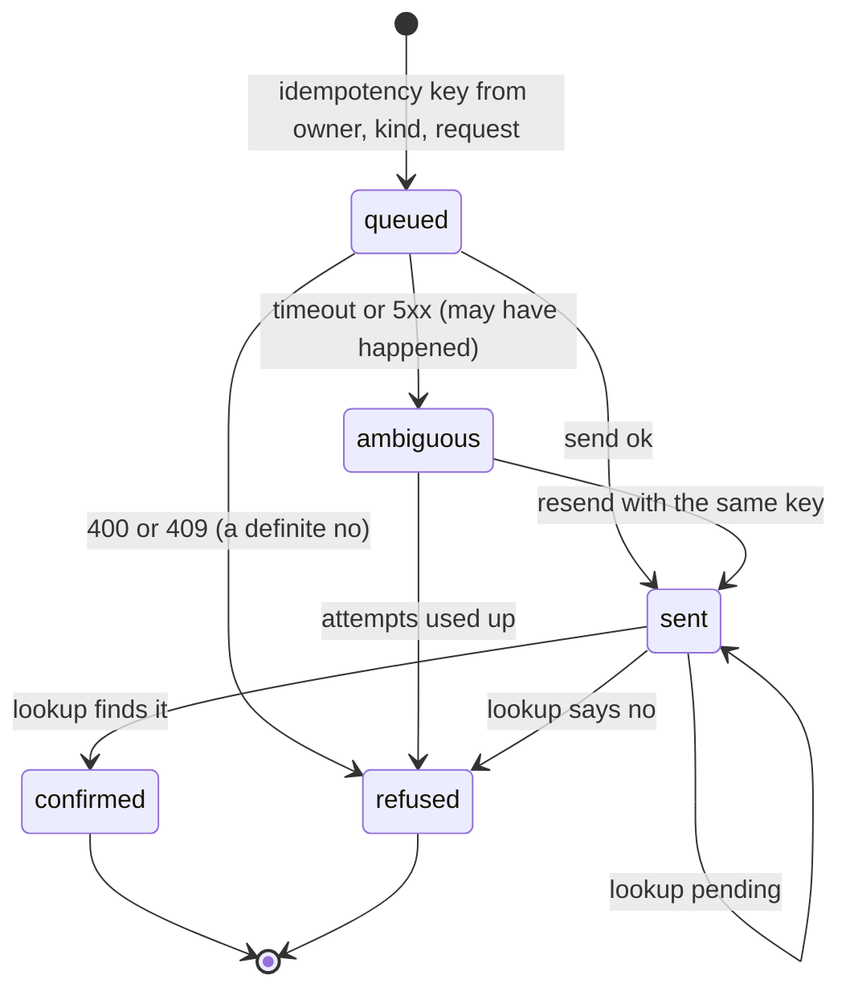
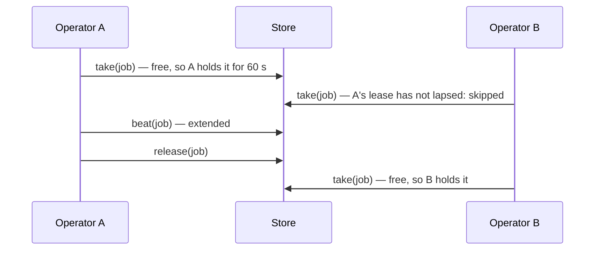

# @zthr/operator

The parts every persistent operator needs (Patterns 24 to 26), with no knowledge of what its jobs do: leases with
heartbeats so a job never runs twice at once, dispatches that are "sent" until a lookup confirms them, and holds
that record what a person loses when a job does not run.

## Use it for

Background work that writes to someone else's system on a person's behalf (bookings, requests, submissions), and any scheduled job that two processes might both try to run. Hand `Leases` any store with get, put and remove.

## Not for

Conversations (they stay synchronous and answer from cached data), exactly-once delivery across systems that ignore idempotency keys, or scheduling itself (the app owns its clock and job list).

## Verified by

<!-- verified-by:start -->
- [`packages/operator/test/operator.test.ts`](../../packages/operator/test/operator.test.ts) (14 test definitions)
<!-- verified-by:end -->
