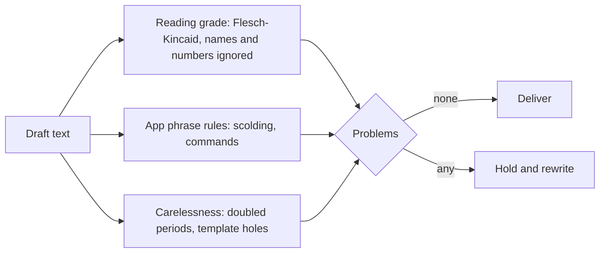

# @zthr/plain-language

Measures whether writing is plain and kind, deterministically, before any model offers a second opinion
(Pattern 19, the determinism ladder). It knows nothing about any one app: the app supplies its own phrase rules.

## Use it for

Any text a person will read from an automated system: reading grade against their chosen level, phrase rules for tone, and catching careless output. `sentence()` closes a sentence once, so "5 p.m." never becomes "5 p.m..".

## Not for

Languages other than English for the grade (the formula is English-only; the app records Spanish grade as not measured), judging meaning or accuracy, or translation.

## Verified by

<!-- verified-by:start -->
- [`packages/plain-language/test/plain-language.test.ts`](../../packages/plain-language/test/plain-language.test.ts) (11 test definitions)
<!-- verified-by:end -->
