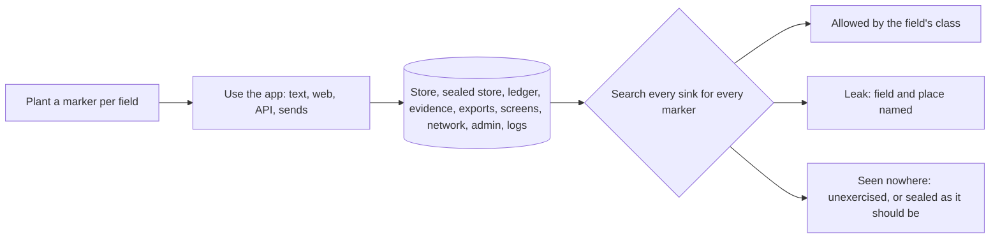

# @zthr/privacy

Traces where a person's data actually goes, and keeps counts from pointing at anyone. A unique marker is planted
in every personal, sensitive and secret field; the app is used the way a person would use it; every place data can
land is searched. Where a marker turns up is where that field went, and the policy says whether it may.

## Use it for

Proving, on every build, that sensitive facts reach only the places their class allows, and finding the field that leaked and where. `safeRate` and `safeCount` suppress any figure about fewer than five people.

## Not for

Detecting sensitive data you did not plant (it traces declared fields, not free text a person types into a note), encryption (the runtime block seals facts), or access control (the app's sign-in and roles decide who sees what).

## Verified by

<!-- verified-by:start -->
- [`packages/privacy/test/privacy.test.ts`](../../packages/privacy/test/privacy.test.ts) (6 test definitions)
<!-- verified-by:end -->
