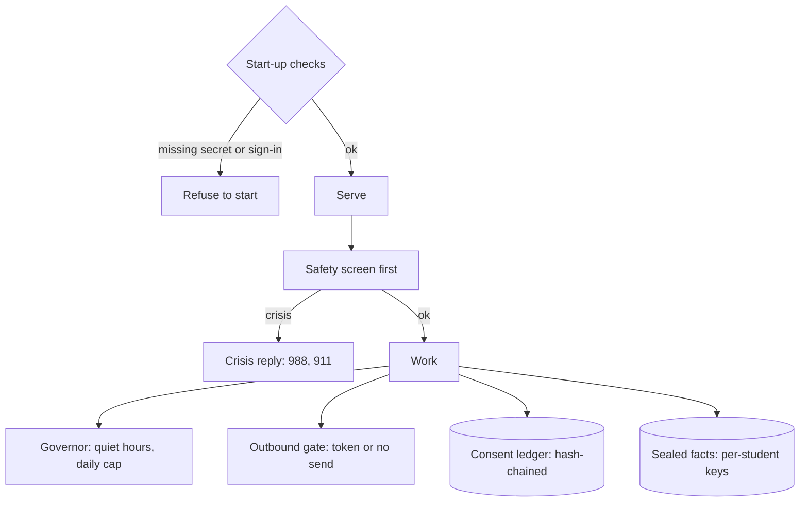

# @zthr/runtime

What keeps a running product safe: approval tokens and the outbound gate, the contact governor, the safety screen
and crisis replies, the deterministic sandwich around any model, the consent ledger, sealed facts, and refusing
to start misconfigured.

## Use it for

The safety screen, sealed facts and their consent ledger, approval tokens and the outbound gate, refusing to start misconfigured, and the deterministic sandwich.

## Not for

The app's own business rules.

## Verified by

<!-- verified-by:start -->
- [`packages/runtime/test/hardening.test.ts`](../../packages/runtime/test/hardening.test.ts) (4 test definitions)
- [`packages/runtime/test/runtime.test.ts`](../../packages/runtime/test/runtime.test.ts) (15 test definitions)
<!-- verified-by:end -->
