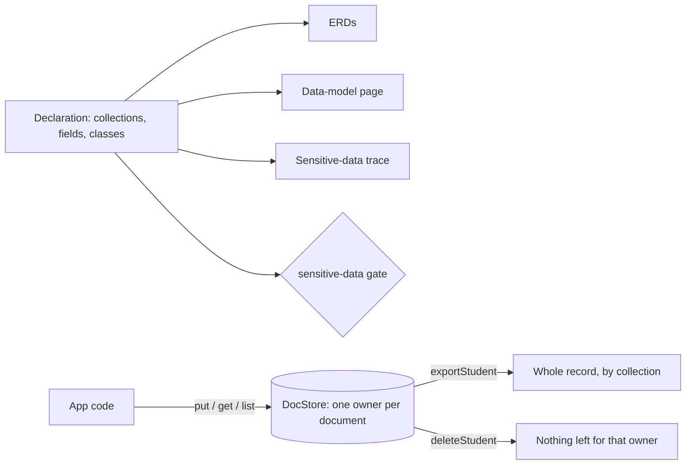

# @zthr/store

A document store where every document has one owner, and a declaration of every collection and field with how
sensitive each field is. Export and deletion of a person's whole record are one query each. The data-model page,
the ERDs and the sensitive-data trace are all generated from the declaration, so the pictures cannot drift.

The five classes, from least to most sensitive:

| Class | Means | Example |
| --- | --- | --- |
| public | Published facts anyone may read | A dining hall's hours |
| internal | Ids, times and settings that say nothing about a person alone | A message's status |
| personal | Identifies or describes the person | Name, phone, class schedule |
| sensitive | Special-category facts | Income, benefits, health, family, which help they need |
| secret | Credentials | A webhook's signing secret, a class-site token |

## Use it for

Any app that keeps records about people and must be able to hand a person their whole record or erase it. Declare every collection once with `field(name, type, class)`; draw it with `erd()`; check it with `unclassified()`.

## Not for

Shared reference data with no owner (give it a system owner, as the operator does with `_operator`), append-only logs (use the evidence block or a ledger), or facts that must be encrypted at rest (seal them with the runtime block's sealed store).

## Verified by

<!-- verified-by:start -->
- [`packages/store/test/store.test.ts`](../../packages/store/test/store.test.ts) (8 test definitions)
<!-- verified-by:end -->
