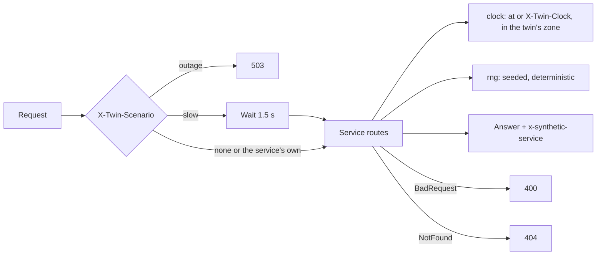

# @zthr/twin-service

Everything a synthetic service needs to behave like a real vendor's API (Pattern 33): a clock you can set, bad-day
scenarios on request, health and a generated OpenAPI document, plain JSON errors, and seeded randomness so the
same request at the same clock always gets the same answer.

## Use it for

Standing in for a service you do not own (dining, transit, room booking, a job board, a learning platform) so tests, walks and demos can rely on it, with a contract that a real vendor can later be checked against.

## Not for

Production data, services you do own (test the real one), or load testing (it answers in-process and fast).

## Verified by

<!-- verified-by:start -->
- [`packages/twin-service/test/twin-service.test.ts`](../../packages/twin-service/test/twin-service.test.ts) (10 test definitions)
<!-- verified-by:end -->
