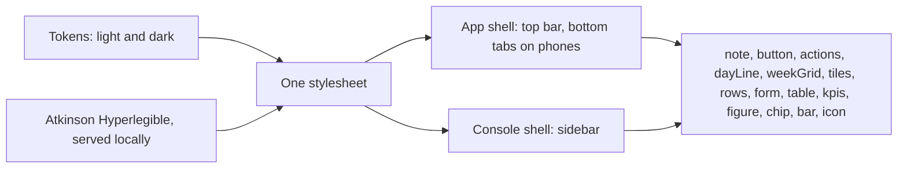

# @zthr/ui

Server-rendered building blocks for any factory app. Every component returns HTML and escapes everything it
renders, so no component can be the source of an injection. Pages work without JavaScript.

| Token | Light | Dark | Used for |
| --- | --- | --- | --- |
| paper | #f4f6f3 | #0e1513 | page background |
| surface | #ffffff | #151f1c | panels and notes |
| ink | #16231f | #e6eee9 | text |
| action | #0d6a5b | #5fcfb6 | buttons, links, classes on the day line |
| mark | #f2b233 | #f2b233 | the one thing, held time, call buttons |
| alert | #a8432c | #f08a6c | heads-up, safety, due |

The typeface is Atkinson Hyperlegible, designed by the Braille Institute for readers with low vision.

## Use it for

Escaped HTML components, light and dark tokens, and the shells for the app and the consoles, shared by every screen.

## Not for

Client-side state, frameworks, or anything that renders unescaped input.

## Verified by

<!-- verified-by:start -->
- [`packages/ui/test/ui.test.ts`](../../packages/ui/test/ui.test.ts) (16 test definitions)
<!-- verified-by:end -->
