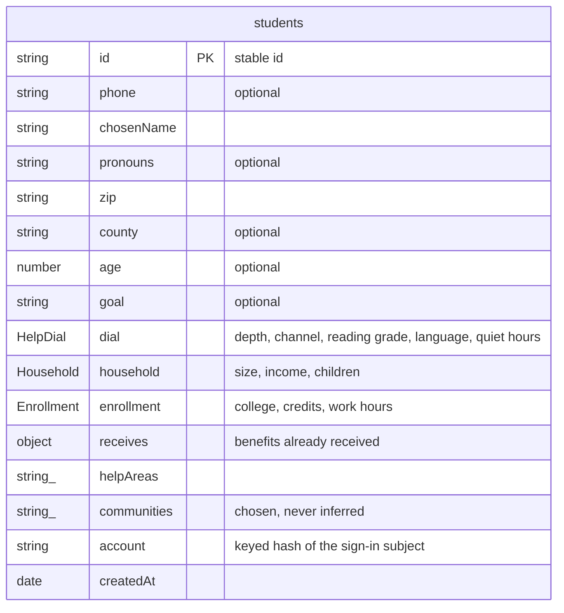
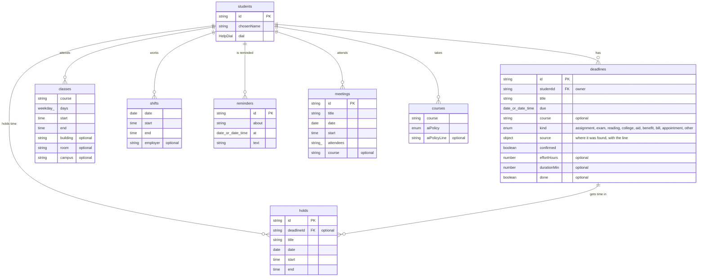
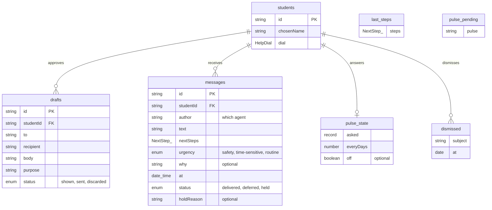
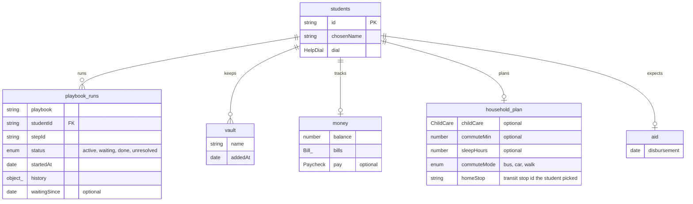
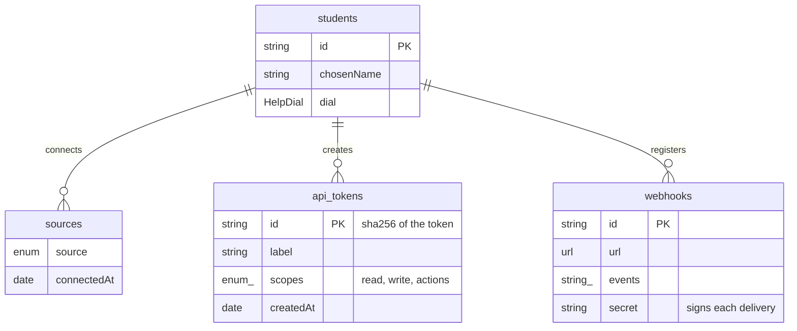
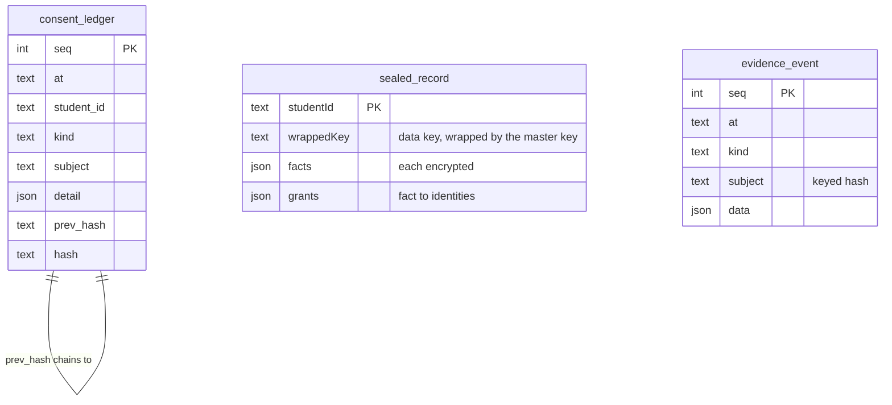
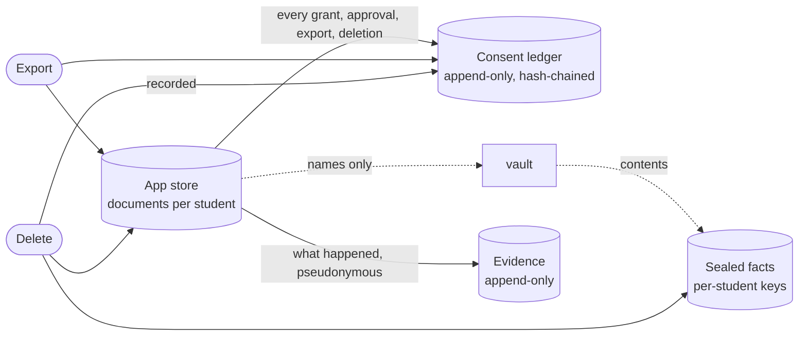

# Data model

<!-- generated by tools/docs.ts from apps/advocate/src/domain/schema.ts; do not edit by hand -->

The Advocate keeps a student's record in one document store, one collection per kind of thing, every document
owned by exactly one student, so export and deletion are a single query each. Three other stores sit beside it,
each with its own guarantee.

## The student

## The record: schedule

## The record: conversation

## The record: help and money

## The record: connections

| Collection | Key | What it holds |
| --- | --- | --- |
| `students` | id | Who the student is and how they want to be helped. Sealed facts are never stored here. |
| `deadlines` | id | Every date that matters: assignments, exams, aid, bills, appointments. Found dates stay unconfirmed until the student checks them. |
| `classes` | student:course:index | Weekly class meetings, from the schedule or a room-change email. |
| `shifts` | student:date:start | Work shifts, typed by the student or sent through the API. |
| `holds` | id | Time the student asked the Advocate to keep for a piece of work. |
| `reminders` | id | Reminders the student asked for. |
| `drafts` | id | Messages the Advocate wrote for the student to send. Nothing leaves without the student approving the exact text. |
| `messages` | id | Everything the team said to the student, with why and what the tone gate decided. |
| `last_steps` (transient) | student | The choices on the last message, so a reply of "1" by text picks the first. |
| `playbook_runs` | student:playbook | Where the student is in each playbook, with every checkpoint. |
| `pulse_state` | student | Quick questions: which were asked when, how often, or off. |
| `pulse_pending` (transient) | student | A quick question waiting for a yes or no. |
| `sources` | student:source | What the student connected: calendar, forwarding, class site, location. Each grant is also in the consent ledger. |
| `api_tokens` | sha256(token) | Tokens the student created to connect other tools. Only a hash is stored. |
| `webhooks` | id | Where the student asked to be notified. Https only; payloads carry ids, never message text. |
| `vault` | student:name | Names of documents the student keeps; contents are sealed. |
| `money` | student | Balance, bills and pay, for spotting a short month ahead of time. |
| `household_plan` | student | Child care hours, commute and sleep, for the week solver. |
| `commute_plans` (transient) | student|date | Bus trips that get the student to their first class each day, from the transit planner. |
| `transit_now` (transient) | student | Live arrivals and alerts at the student's stop; used only while under ten minutes old. |
| `dispatches` | idempotency key | Writes the student asked for (room bookings), each sent once with an idempotency key and confirmed by looking it up. |
| `campus_feeds` (transient) | campus | What the operator last fetched from each campus service: dining, places, careers and transit stops. Shared, not about any student. |
| `leases` (transient) | job | Which operator holds which job, with a heartbeat, so two never run the same job. |
| `meetings` | id | Group meetings to prepare for. |
| `courses` | student:course | Each course and its AI policy, read from the syllabus. |
| `dismissed` | student:subject | Alerts the student said are fine. |
| `academic` | student | The student's record for staying enrolled: program, finished and current courses with grades, and the aid and charges this term, for standing, aid progress and the withdrawal estimate. |
| `gradebooks` | student:course | Each class's graded categories from the syllabus and the scores in them, from the class site or typed by the student. |
| `shares` | sha256(token) | Read-only links the student made for an advisor or anyone they choose. Only a hash of the link is kept; each view is in the consent ledger. |
| `aid` | student | When financial aid is expected, for book timing. |

## The other stores

| Store | Guarantee |
| --- | --- |
| consent ledger | Every grant, revoke, approval, export and deletion, hash-chained and append-only. |
| sealed facts | Facts only granted identities can open; encrypted with a per-student key wrapped by the master key. |
| evidence | What the factory and the product did, pseudonymous and append-only; never message content. |

## How the stores relate

## Verified by

<!-- verified-by:start -->
- [`apps/advocate/test/schema.test.ts`](../apps/advocate/test/schema.test.ts) (6 test definitions)
<!-- verified-by:end -->
