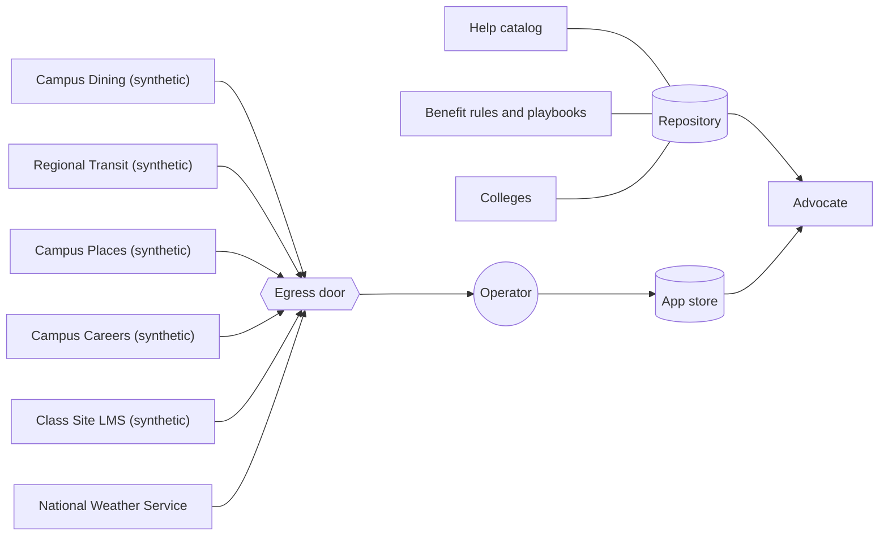
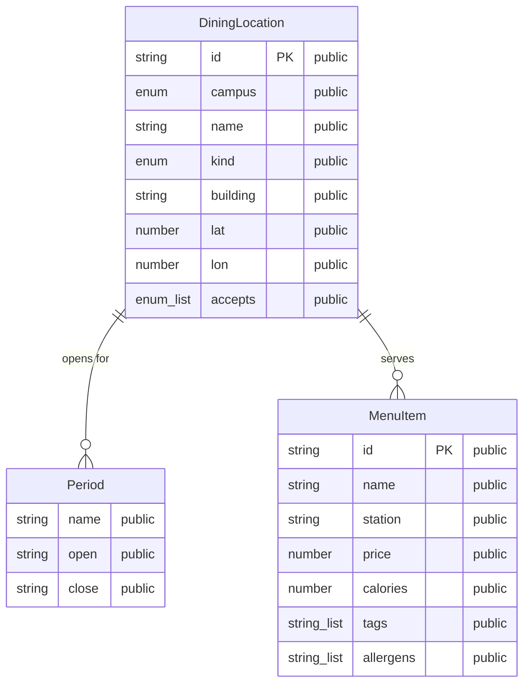
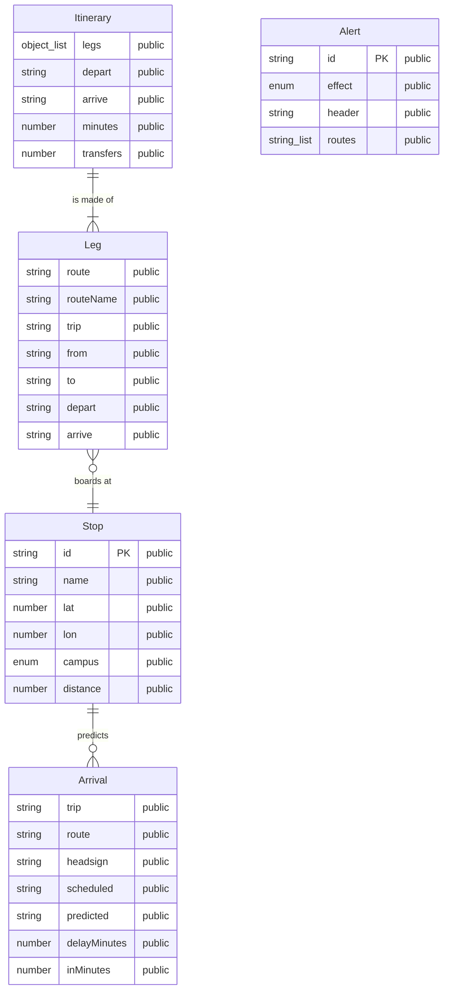
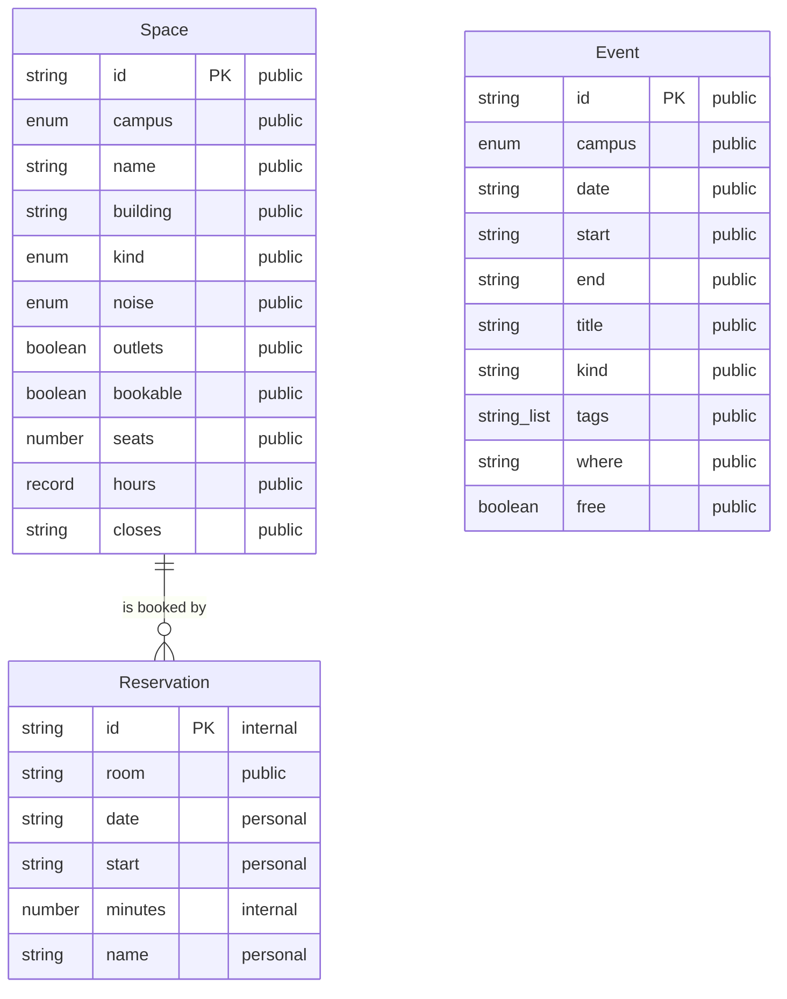
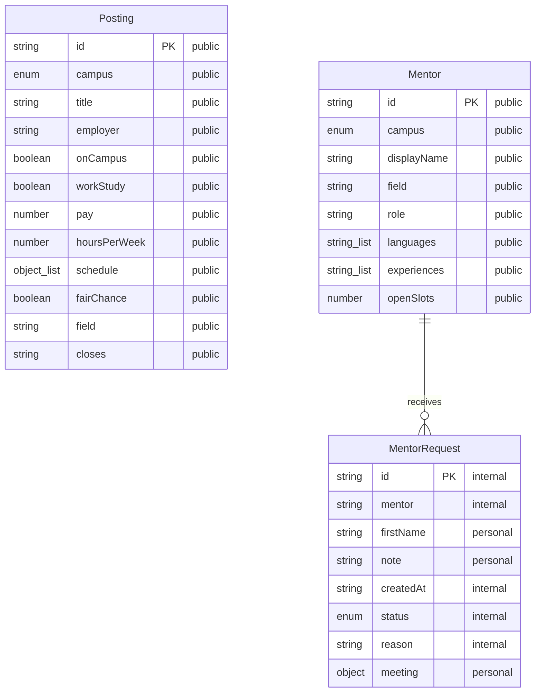
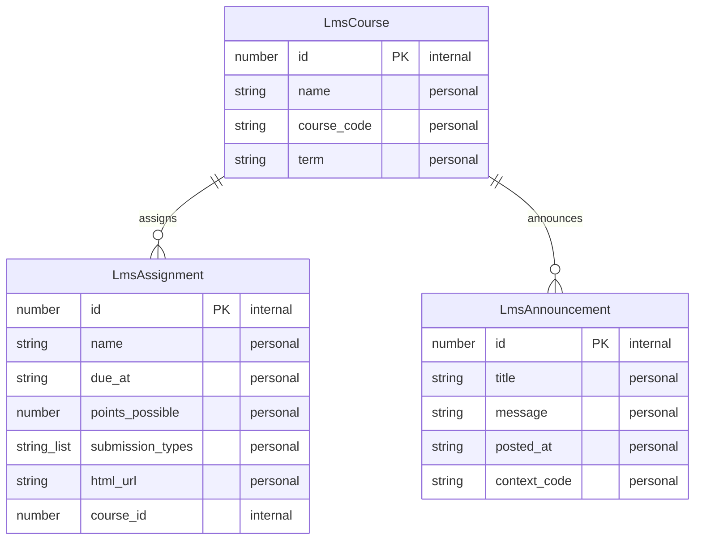
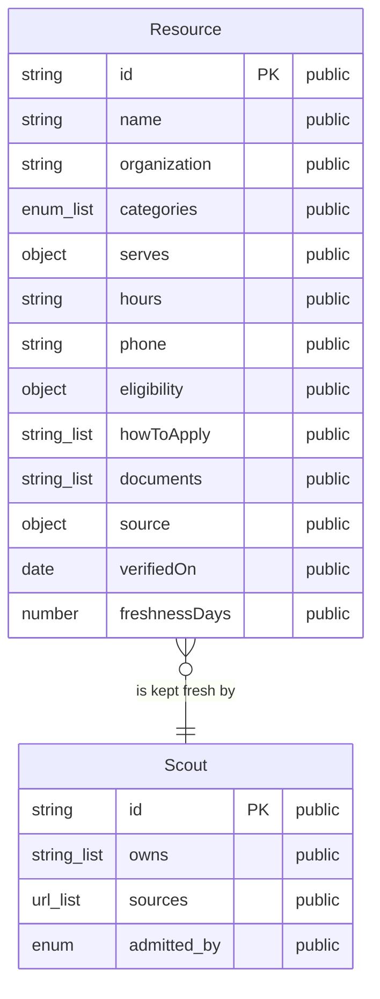
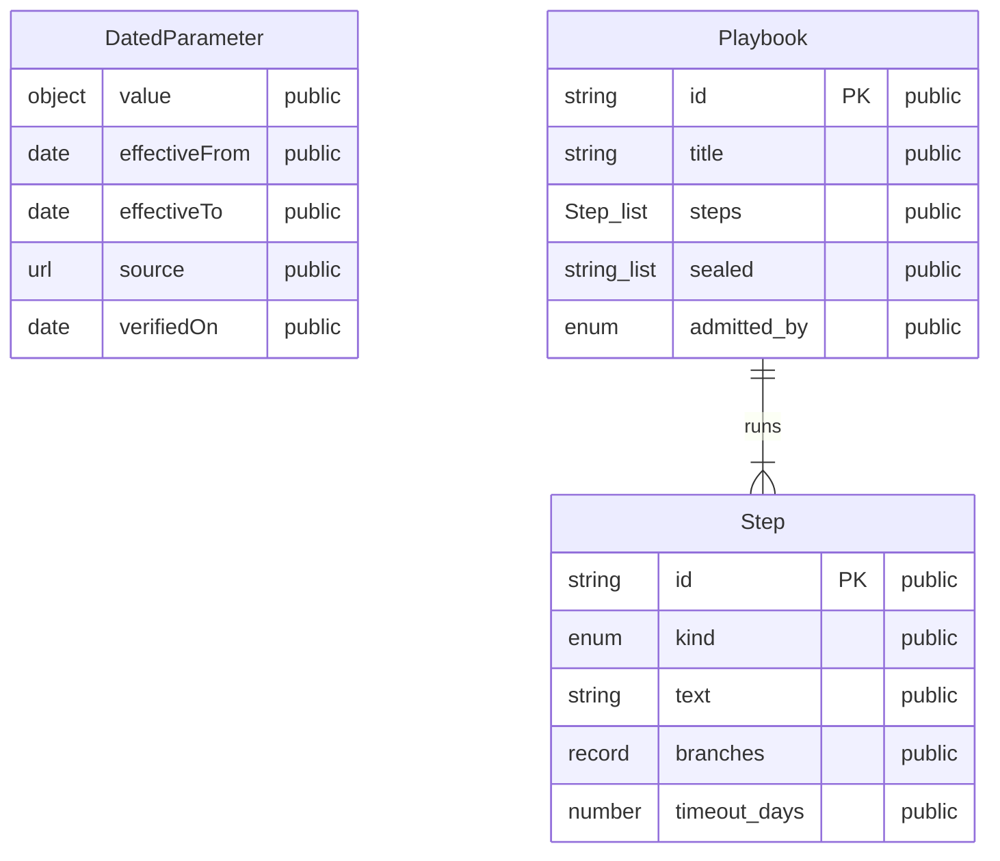
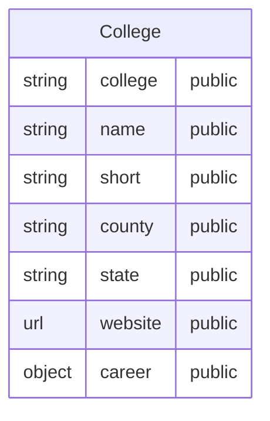
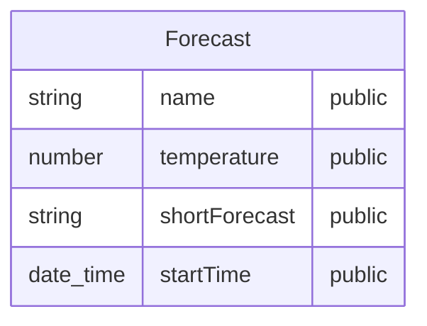

# Data sources

<!-- generated by tools/sources.ts from the campus contracts and the repository's reference data; do not edit by hand -->

Everything the Advocate reads that it does not own. Campus services are reached only through the egress door,
fetched by the operator on a schedule, parsed against their contracts, and kept as shared feeds; a vendor that
drifts from its contract produces an unknown, never a wrong answer. Reference data lives in the repository, dated
and sourced. Each ERD below is drawn from the same schema the contract tests enforce; every field shows its
sensitivity class (see [Sensitive data](flows/sensitive-data.md)).

| Source | Kind | How it is read | Where it lands |
| --- | --- | --- | --- |
| Campus Dining (synthetic) | campus service (synthetic twin) | The operator fetches locations, a week of hours and today's menus for each student's campus. | campus_feeds (shared, not about any student) |
| Regional Transit (synthetic) | campus service (synthetic twin) | GTFS-style routes and stops, a trip planner, and live arrivals and alerts. The operator plans each bus rider's trip to their first class; live times count for ten minutes. | campus_feeds.stops (shared); commute_plans and transit_now (per student) |
| Campus Places (synthetic) | campus service (synthetic twin) | Study spaces, room availability and campus events (free food among them). A booking is a dispatch with an idempotency key, confirmed by looking it up. | campus_feeds (spaces, events); dispatches (bookings, per student) |
| Campus Careers (synthetic) | campus service (synthetic twin) | Job postings with weekly schedules and a fair-chance flag, and a mentor directory. An introduction the student approves sends only their first name and note. | campus_feeds (postings, mentors); dispatches (introductions) |
| Class Site LMS (synthetic) | campus service (synthetic twin) | The student's own courses, assignments and announcements, read with their class-site token (sealed, granted only to the sync). | deadlines (assignments, deduplicated by class-site id); classes (room changes) |
| Help catalog | reference data in the repository | Verified programs and services, shaped after the Open Referral data specification. Each entry has a source and a verification date; stale entries are never offered as current. | read in place; nothing copied per student |
| Benefit rules and playbooks | reference data in the repository | Dated parameters (poverty guidelines, SNAP limits) with sources and effective periods; playbooks as declared steps. A date outside every period answers unconfirmed, never a stale number. | read in place; playbook progress lands in playbook_runs |
| Colleges | reference data in the repository | One file per college: name, county, website and career center. Adding a college is adding a file; the builder drafts its county scouts. | read in place |
| National Weather Service | public web service | The forecast for the student's campus, through the egress door, for weather closures and bus delays. | used in the moment; not stored |

## Campus Dining (synthetic)

The operator fetches locations, a week of hours and today's menus for each student's campus.

## Regional Transit (synthetic)

GTFS-style routes and stops, a trip planner, and live arrivals and alerts. The operator plans each bus rider's trip to their first class; live times count for ten minutes.

## Campus Places (synthetic)

Study spaces, room availability and campus events (free food among them). A booking is a dispatch with an idempotency key, confirmed by looking it up.

## Campus Careers (synthetic)

Job postings with weekly schedules and a fair-chance flag, and a mentor directory. An introduction the student approves sends only their first name and note.

## Class Site LMS (synthetic)

The student's own courses, assignments and announcements, read with their class-site token (sealed, granted only to the sync).

## Help catalog

Verified programs and services, shaped after the Open Referral data specification. Each entry has a source and a verification date; stale entries are never offered as current.

## Benefit rules and playbooks

Dated parameters (poverty guidelines, SNAP limits) with sources and effective periods; playbooks as declared steps. A date outside every period answers unconfirmed, never a stale number.

## Colleges

One file per college: name, county, website and career center. Adding a college is adding a file; the builder drafts its county scouts.

## National Weather Service

The forecast for the student's campus, through the egress door, for weather closures and bus delays.

## Verified by

<!-- verified-by:start -->
- [`tools/test/sources.test.ts`](../tools/test/sources.test.ts) (3 test definitions)
<!-- verified-by:end -->
