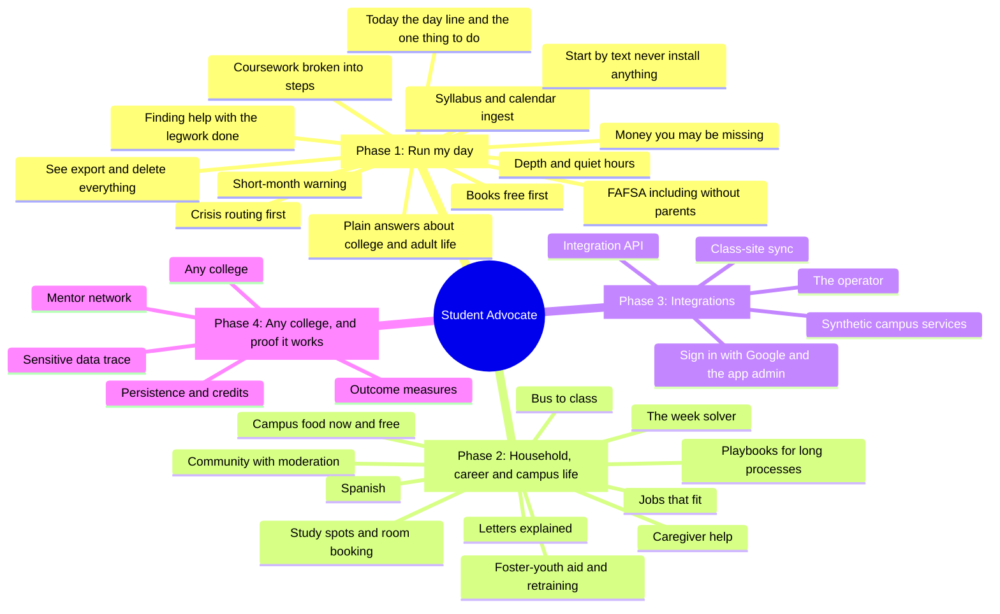

# Features

<!-- generated by tools/features.ts from control/features.yaml; do not edit by hand -->

Everything the Student Advocate does, by phase. 34 features: 32 built, 1 partial, 1 not measured. Each names the locked journeys that prove it; the factory console shows whether each journey passed in this build.

## Phase 1: Run my day

| Feature | What it does | Where | Status | Proven by |
| --- | --- | --- | --- | --- |
| Today, the day line and the one thing to do | Classes, shifts, held time and due dates on one line, with the single most useful thing to do today. | Today | built | `persona-6a-calendar-mastery`, `persona-12b-work-fitted-coursework` |
| Syllabus and calendar ingest | A pasted syllabus or calendar feed becomes dates, held for a quick check before they are planned around. | Dates, Syllabus | built | `persona-6a-calendar-mastery` |
| Coursework broken into steps | A big assignment split into short steps placed in open time, with the course's AI policy respected. | Today, Week | built | `persona-8a-small-steps`, `persona-12b-work-fitted-coursework` |
| Money you may be missing | SNAP, Lifeline, HEAP and campus emergency grants checked against published limits, with the rule shown. | Money | built | `persona-7b-money-and-shifts`, `persona-10c-aid-that-fits` |
| Short-month warning | A rent or bill shortfall seen before the first of the month, with real ways to cover it. | Today, Money | built | `persona-1b-bill-gap` |
| Finding help, with the legwork done | Verified, current programs near the student, what to bring, and a drafted message to send. | Help | built | `req-stale-never-offered`, `persona-3c-no-judgment` |
| Crisis routing first | Words that signal danger go straight to 988 or 911 information before anything else. | Every screen, text | built | `req-crisis-routing` |
| FAFSA, including without parents | The FAFSA as a playbook, with the unusual-circumstances path when parents cannot be included. | Help | built | `persona-11a-fafsa-without-parents` |
| Plain answers about college and adult life | College words, leases, bank accounts and taxes explained plainly, with licensed help named where needed. | Ask | built | `persona-5b-college-explained`, `persona-2c-adult-know-how` |
| Books, free first | Free and cheaper ways to get course materials, timed to financial aid. | Money | built | `persona-5c-money-saved` |
| Start by text, never install anything | The whole Advocate by text message, with numbered choices and carrier opt-out honored. | Text | built | `persona-9a-simple` |
| Depth and quiet hours | Brief, standard or walk-me-through answers at a chosen reading level, and nothing routine during quiet hours. | You | built | `persona-4c-short-and-direct`, `req-quiet-hours` |
| See, export and delete everything | What the team knows, every source switchable, a full export, and deletion in one step. | You | built | `persona-10a-privacy` |

## Phase 2: Household, career and campus life

| Feature | What it does | Where | Status | Proven by |
| --- | --- | --- | --- | --- |
| The week solver | Rotating shifts, classes, child care drop-off and pickup, commute and sleep fitted into one week. | Week | built | `persona-1a-week-puzzle`, `persona-8b-predictability` |
| Playbooks for long processes | GI Bill certification, accommodation letters, break housing, enrollment proof and SNAP recertification, tracked to the end. | Help, Drafts | built | `persona-4a-gi-bill-tracked`, `persona-8c-accommodation-letters`, `persona-2a-break-housing`, `persona-3a-parole-schedule-proof`, `playbook-snap-recertification` |
| Foster-youth aid and retraining | Independent FAFSA status and education vouchers for former foster youth; workforce training funds after a layoff. | Help | built | `p2-foster-youth-aid`, `p2-retraining` |
| Letters explained | A pasted agency letter explained in plain words, with what to do and by when. | Letter | built | `persona-9b-letter-explained` |
| Caregiver help | The Eldercare Locator and county caregiving programs, kept fresh by a scout the factory admitted. | Help | built | `scout-montgomery-caregiving` |
| Campus food, now and free | What is open to eat right now and until when, late food, and free food at campus events today. | Help, text | built | `p2-food-on-campus-late` |
| Study spots and room booking | Quiet spaces open now, and a room booked once and reported booked only after the room system confirms it. | Help | built | `p2-study-room-booked-once` |
| Bus to class | When to leave for the first class each day, with live delays and alerts, and a late note to draft. | Today | built | `p2-bus-to-class` |
| Jobs that fit | Open jobs whose hours fit around classes and shifts, and a fair-chance path when the student asks. | Help | built | `p2-jobs-that-fit` |
| Community with moderation | Opt-in groups with moderation that holds anything identifying or unkind. | Help | built | tests and gates |
| Spanish | Spanish from the first text through finding help and crisis replies; other screens answer in English for now. | Text, Help | partial | `persona-10b-spanish` |

## Phase 3: Integrations

| Feature | What it does | Where | Status | Proven by |
| --- | --- | --- | --- | --- |
| Integration API | Ingest dates, shifts, syllabi and email; export everything; webhooks that carry ids, never content. | API | built | tests and gates |
| Class-site sync | Every assignment from the class site once, moved dates followed with a message, room changes applied. | Dates, Today | built | `p3-class-site-sync` |
| Synthetic campus services | Dining, transit, places, careers and a class site as real HTTP APIs with contracts and bad-day scenarios. | /twins | built | tests and gates |
| The operator | Background jobs under leases; writes sent with idempotency keys and confirmed by lookup. | background | built | `p2-study-room-booked-once` |
| Sign in with Google, and the app admin | Google sign-in in production; an admin that shows counts and the catalog, never a student's record. | Admin | built | tests and gates |

## Phase 4: Any college, and proof it works

| Feature | What it does | Where | Status | Proven by |
| --- | --- | --- | --- | --- |
| Any college | A college declared in one file; the builder drafts its county scouts for the factory to admit. | background | built | `scout-clark-basic-needs` |
| Mentor network | Introductions that share only a first name and an approved note; a yes puts the meeting on the calendar. | Help | built | `p4-mentor-introduction` |
| Outcome measures | What changed for students, never shown for a group smaller than five. | Admin, API | built | tests and gates |
| Sensitive data trace | Every field classified; planted markers prove where each personal and sensitive fact can go. | background | built | tests and gates |
| Persistence and credits | Needs a college's own records for students who opt in; not estimated from app activity. | background | not measured | tests and gates |

## Verified by

<!-- verified-by:start -->
- [`tools/test/features.test.ts`](../tools/test/features.test.ts) (7 test definitions)
<!-- verified-by:end -->
