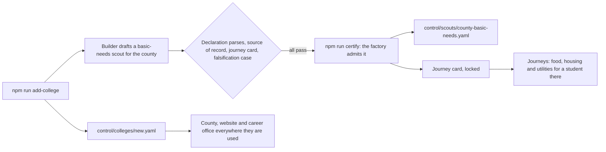
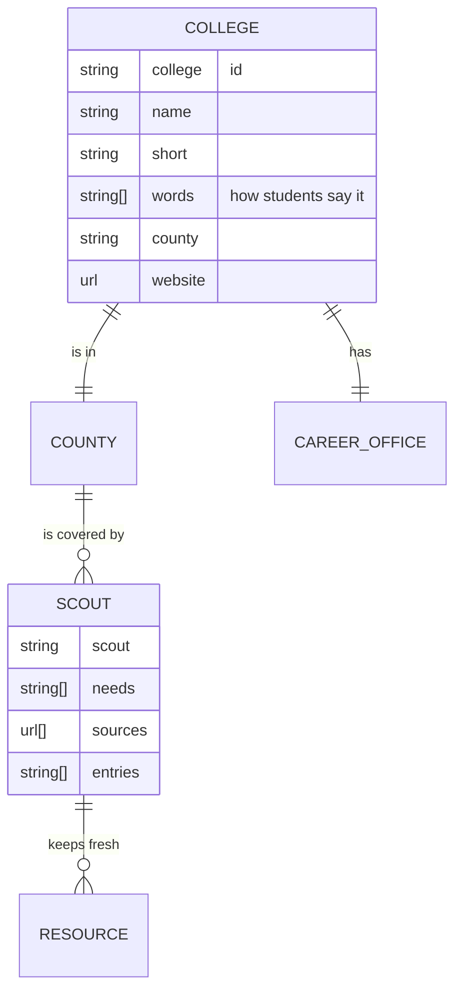

# Any college

Everything the Advocate knows about a college lives in one declared file in `control/colleges`: its name and the
words students use for it, its county, its website and its career office. Adding a college is one command; the
builder drafts the scouts its county needs, the factory admits them when their checks pass, and the journeys prove
students there are served, or told plainly what is not verified yet.

A new county starts with a scout whose entries are empty. Until its sources are checked, a student there is offered
the statewide and national programs that serve them, and every other need is answered plainly and counted as a
gap, which is what the builder reads to decide what to draft next.

## Verified by

<!-- verified-by:start -->
- [`apps/advocate/test/colleges.test.ts`](../../apps/advocate/test/colleges.test.ts) (7 test definitions)
<!-- verified-by:end -->
