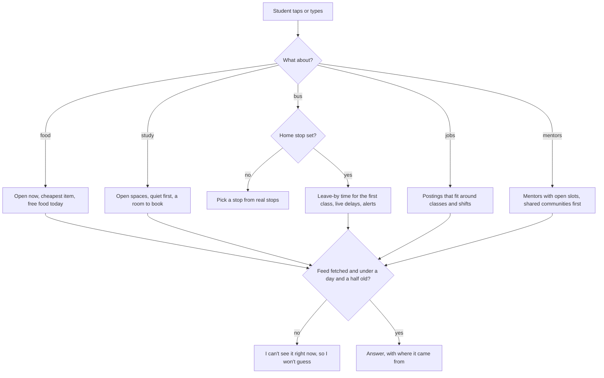
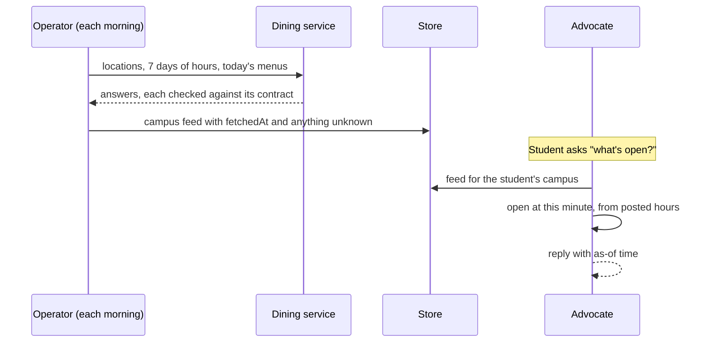
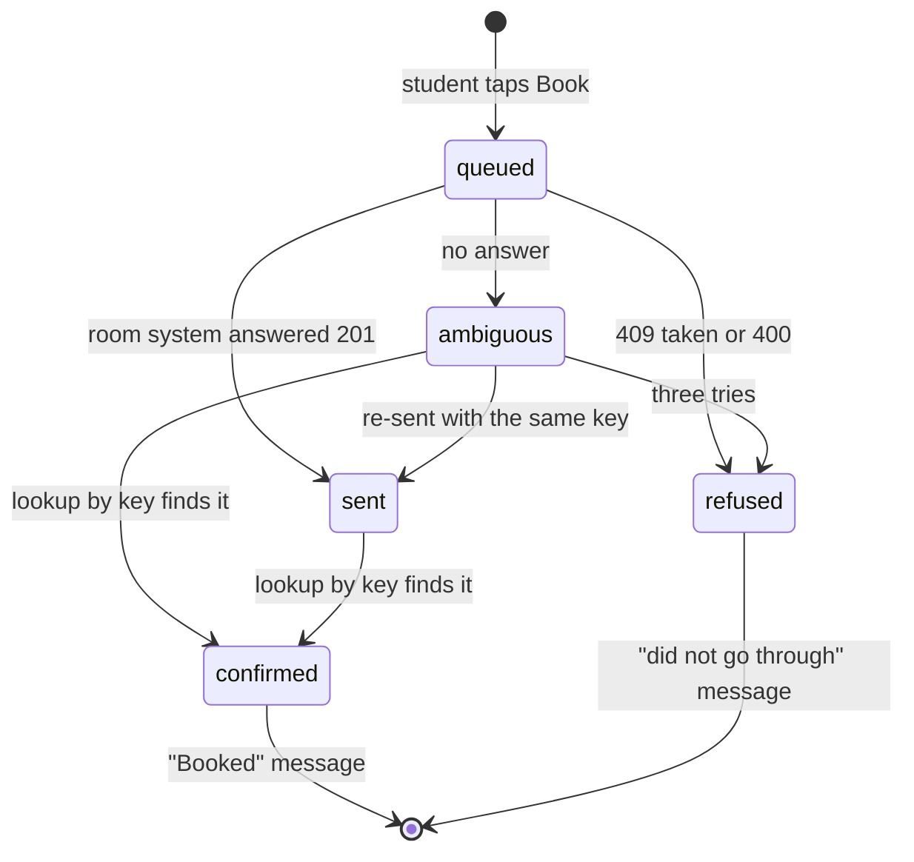

# Campus life, the bus, jobs and mentors

What a student can ask about their own campus, and how each answer is built. Every answer comes from what the
operator last fetched from the college's services, says how old it is, and says plainly when a service could not
be reached. Nothing is sent on the student's behalf without their tap.

## Food on campus

Open now is computed from each location's posted hours, including late hours that run past midnight and
closures for breaks. For each open place it names the cheapest item on today's menu. With nothing open, it says
what opens next.

## Booking a study room

A booking is a write to someone else's system, so it is queued, sent once with an idempotency key, and then
looked up. The student hears "booked" only after the lookup finds it.

## Getting there by bus

The operator plans a trip from the student's stop to every stop on their campus, arriving ten minutes before the
first class, and keeps the latest departure with the fewest transfers. Live arrivals are used only while under ten
minutes old. When a delay would make the student late, the first choice is a short note to the instructor, as a
draft.

| Situation | What the student sees |
| --- | --- |
| No stop set | Which stop do you leave from? (real stops to pick) |
| Plan found | Leave at 7:50 a.m. Take Route 1. You get there at 8:35 a.m. |
| Bus running late | Route 1 is running 6 minutes late right now. |
| Late enough to miss the start | First button: Tell my instructor I may be late |
| No service | No more buses today. Thanksgiving: no service |

## Jobs that fit, and mentors

A posting fits when none of its shifts overlap a class (with 30 minutes to get there) or a work shift the student
entered. Work-study postings come first for work-study students. Fair-chance employers are listed only from the
fair-chance path the student opened themselves, and nothing about it is saved.

Mentors are volunteers with open slots. Those who share a community the student chose come first. An introduction
is a draft that shares only the student's first name and the note.

## Verified by

<!-- verified-by:start -->
- [`apps/advocate/test/campus.test.ts`](../../apps/advocate/test/campus.test.ts) (36 test definitions)
<!-- verified-by:end -->
