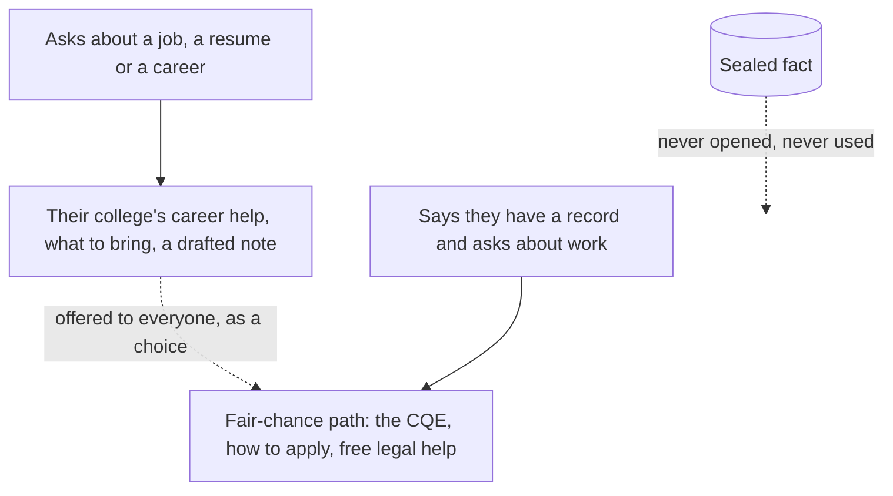

# Jobs and careers

A student asks about work, or taps it on the Help screen. The Advocate points them to their own college's free
career help, says what to bring, and offers to draft a note. For a student who says they have a record, it explains
Ohio's fair-chance path: the Certificate of Qualification for Employment, which can lift automatic bars to many jobs
and job licenses.

The Advocate never infers a record and never uses a sealed fact for this. The student brings it up, or nothing is
said. Nothing about it is saved.

Source for the CQE: the Ohio Department of Rehabilitation and Correction's petition instructions.

## Verified by

<!-- verified-by:start -->
- [`apps/advocate/test/careers.test.ts`](../../apps/advocate/test/careers.test.ts) (8 test definitions)
<!-- verified-by:end -->
