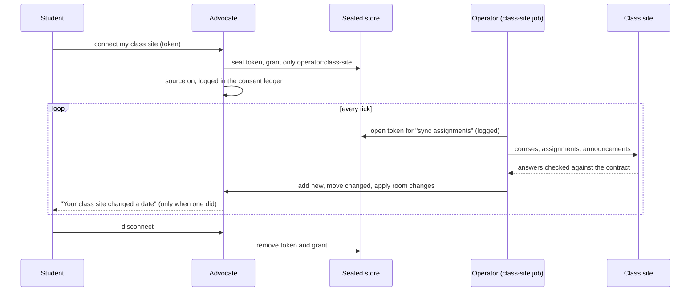
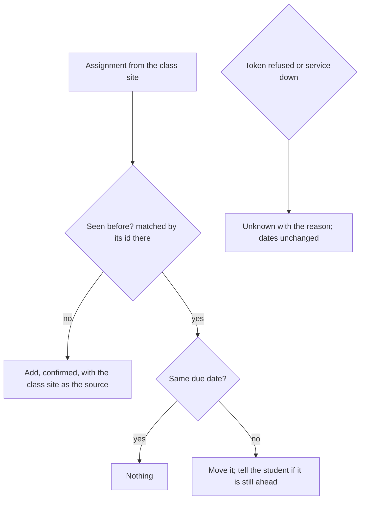

# Class-site sync

A student can connect their class site once. From then on, every assignment and exam is in their dates, a due
date moved by the instructor moves here with a message, and a room change announced on the class site updates
their schedule.

Dates from the class site are confirmed because they come from the instructor's own site, not from reading a
document. The token never appears in an export, a message or the store; only the class-site job can open it, and
every opening is a line in the consent ledger.

## Verified by

<!-- verified-by:start -->
- [`apps/advocate/test/campus.test.ts`](../../apps/advocate/test/campus.test.ts) (36 test definitions)
<!-- verified-by:end -->
