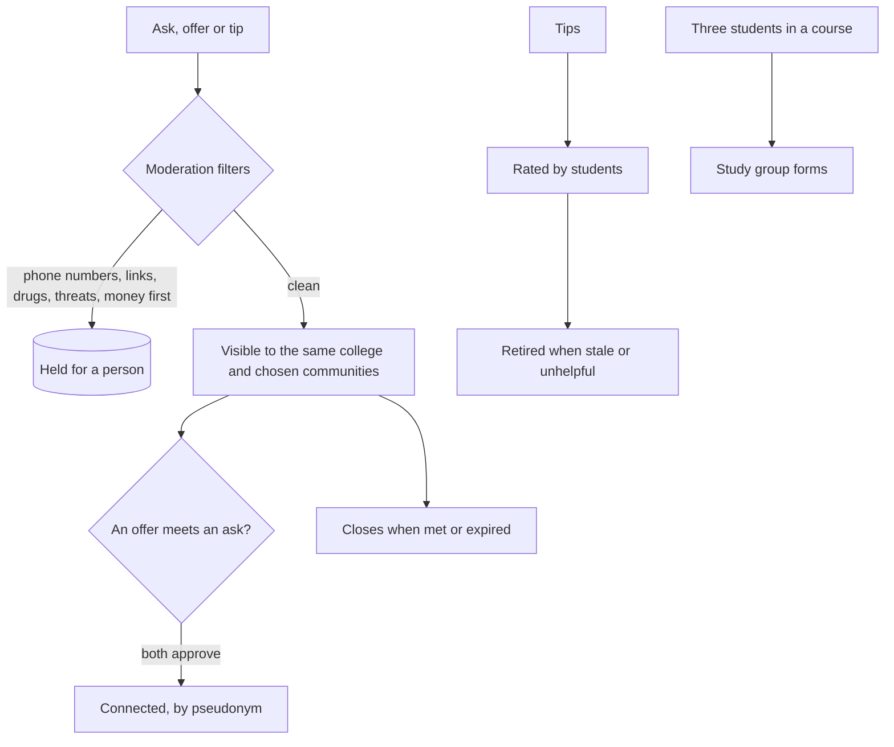

# Community

Students can ask for and offer help, share tips, and find study partners, inside communities they choose. Nothing
is posted under a real name; posts expire; anything risky is held for a person before anyone sees it.

## Verified by

<!-- verified-by:start -->
- [`apps/advocate/test/community.test.ts`](../../apps/advocate/test/community.test.ts) (7 test definitions)
<!-- verified-by:end -->
