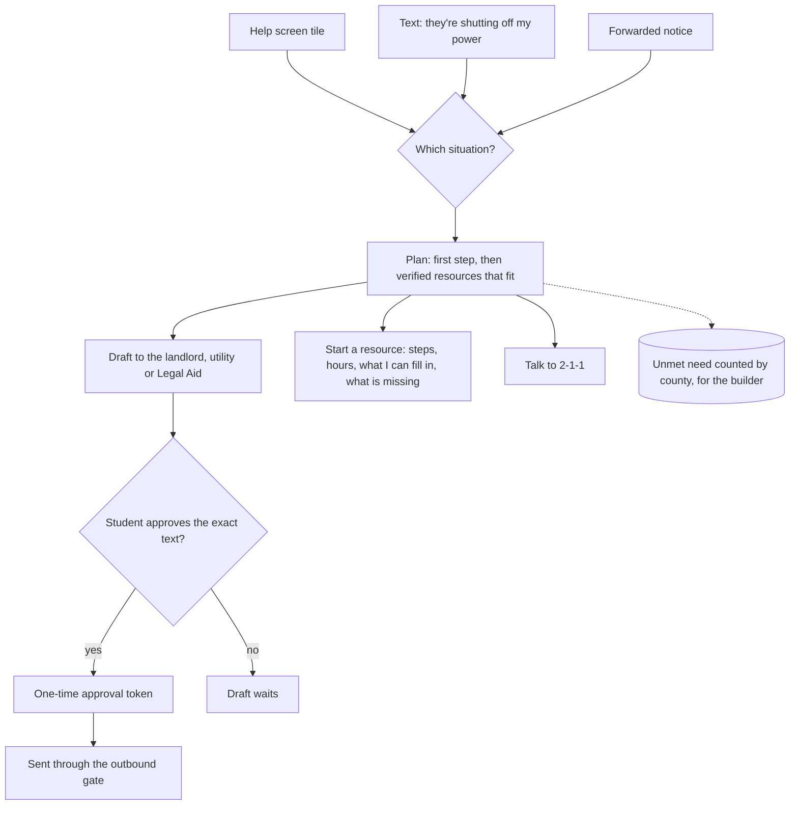

# When something goes wrong

Five situations have a ready plan: eviction notice, utility shut-off, a car that died, no food, and rent that
will be short. A forwarded shut-off or eviction notice starts the same plan without the student asking.

Words of self-harm or violence never reach this flow: the safety router answers first, with 988 and 911.

## Verified by

<!-- verified-by:start -->
- [`apps/advocate/test/hardening.test.ts`](../../apps/advocate/test/hardening.test.ts) (14 test definitions)
<!-- verified-by:end -->
