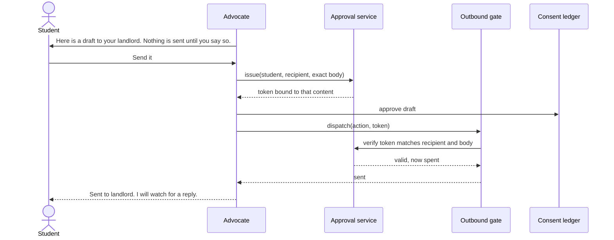

# Drafts and approval

The Advocate writes; the student sends. A send needs an approval token minted from the exact draft the student saw.
A token for one draft cannot send another, cannot be reused, and expires.

The `student-sends` gate proves the outbound gate refuses a send without a token, and is itself proven by a planted
dispatcher that ignores tokens.

## Verified by

<!-- verified-by:start -->
- [`apps/advocate/test/hardening.test.ts`](../../apps/advocate/test/hardening.test.ts) (14 test definitions)
- [`packages/runtime/test/runtime.test.ts`](../../packages/runtime/test/runtime.test.ts) (15 test definitions)
<!-- verified-by:end -->
