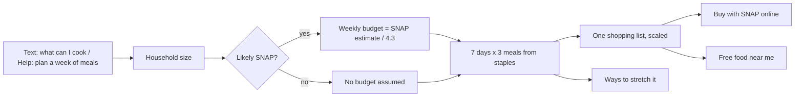

# Meals for the week

A student asks for a meal plan, or taps it on the Help screen. The Advocate plans a week of simple, filling meals
from staples most stores carry and SNAP covers, sized to the household, with one shopping list. When the student
likely qualifies for SNAP, the plan is sized to that estimate split across the month. No prices are quoted: they
change by store and week.

## Verified by

<!-- verified-by:start -->
- [`apps/advocate/test/meals.test.ts`](../../apps/advocate/test/meals.test.ts) (7 test definitions)
<!-- verified-by:end -->
