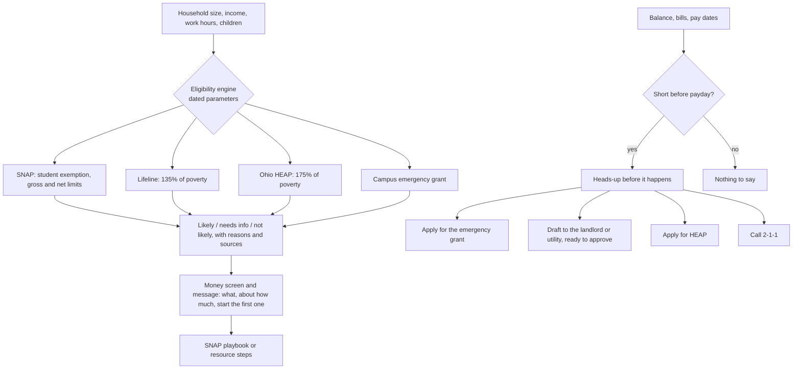

# Money found and short months

The engine never asks about citizenship or immigration status. Programs with status rules say so, and the agency
explains them. Every limit is checked against the published table by the `snap-income-oracle` gate.

## Verified by

<!-- verified-by:start -->
- [`apps/advocate/test/domain.test.ts`](../../apps/advocate/test/domain.test.ts) (14 test definitions)
- [`apps/advocate/test/eligibility.test.ts`](../../apps/advocate/test/eligibility.test.ts) (7 test definitions)
- [`apps/advocate/test/plain-language.test.ts`](../../apps/advocate/test/plain-language.test.ts) (5 test definitions)
<!-- verified-by:end -->
