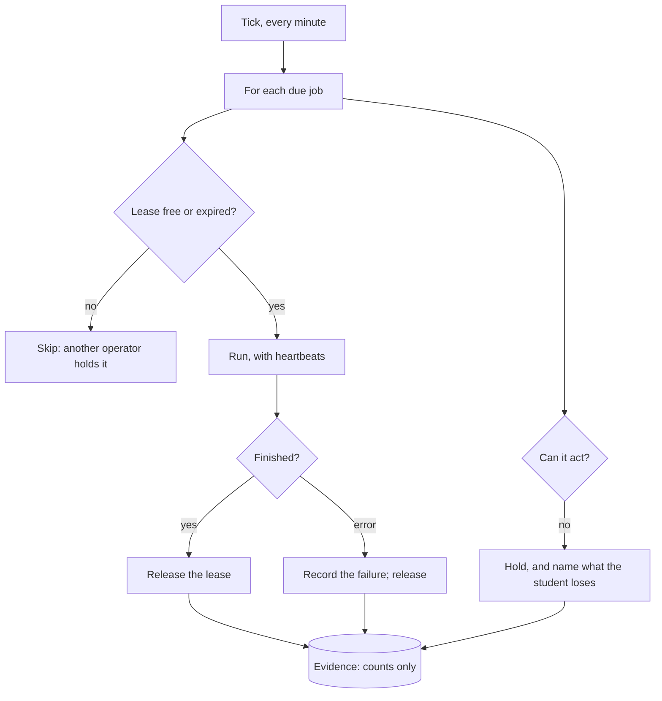
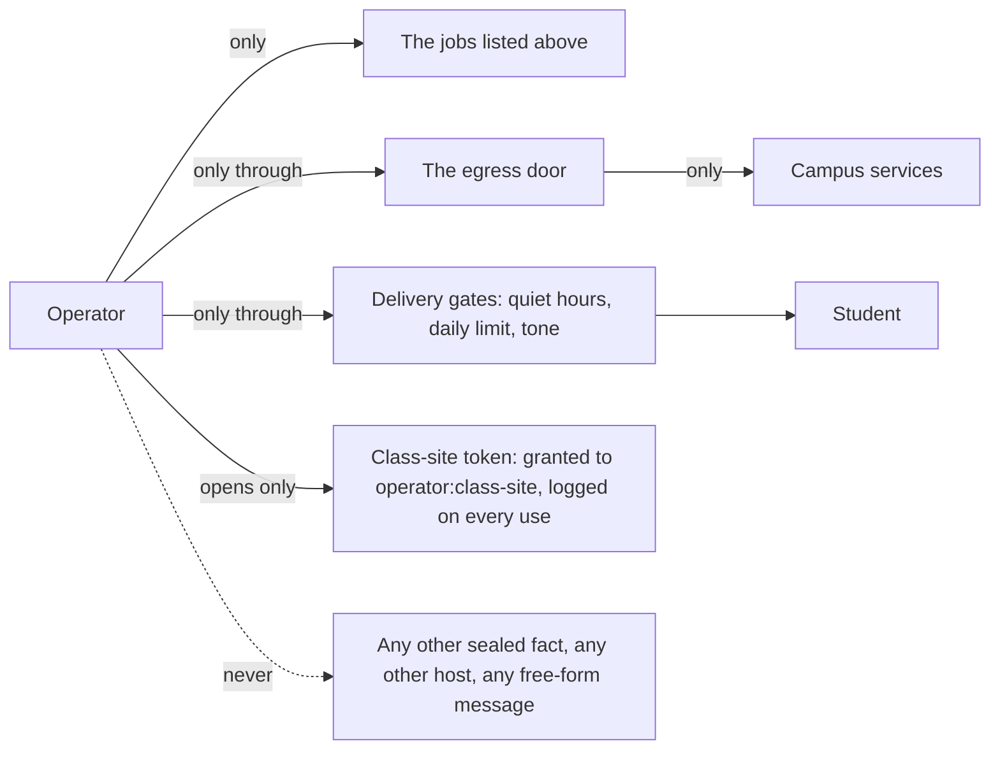
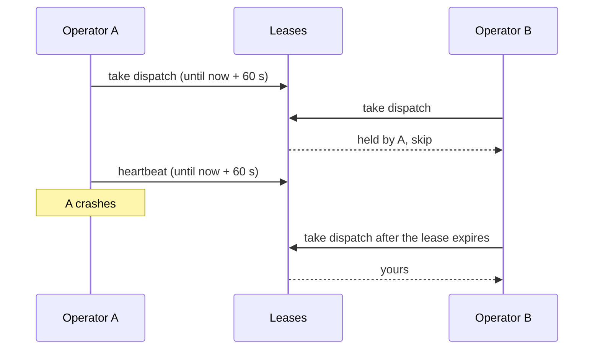

# The operator

The operator is the part of the Advocate that works when no one is asking: it refreshes campus feeds, plans each
bus rider's trips, syncs class sites, and carries out writes the student asked for. It is bounded by structure,
not by its own judgment (Patterns 24 to 27).

## The jobs

| Job | For | What it does |
| --- | --- | --- |
| `campus-feeds:<campus>` | each campus a student attends | Dining locations, hours, menus; spaces and events; postings and mentors; stops |
| `commute:<student>` | bus riders with a stop | A trip to the first class of each of the next 7 days |
| `transit-now:<student>` | bus riders with a stop | Live arrivals and alerts at their stop |
| `class-site:<student>` | students who connected a class site | Assignments into dates, moved dates, room changes |
| `dispatch` | everyone | Sends queued writes with idempotency keys |
| `verify` | everyone | Looks up each sent or ambiguous write before telling the student |

## What bounds it

## Leases

## Verified by

<!-- verified-by:start -->
- [`apps/advocate/test/campus.test.ts`](../../apps/advocate/test/campus.test.ts) (38 test definitions)
<!-- verified-by:end -->
