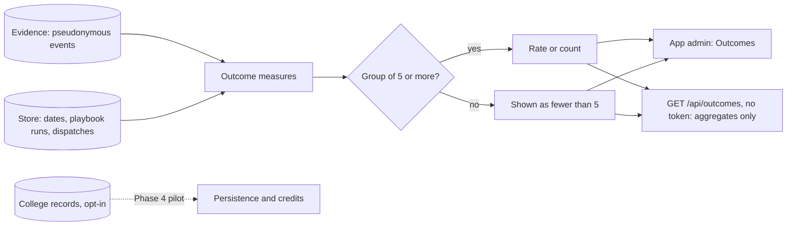

# Outcome measures

What the Advocate changed for students, counted across everyone. No number is shown for a group of fewer than
five, so no figure can point at one person. Each measure says what it counts and what it cannot tell you.
Persistence and credits need a college's own records; until a college shares them for students who opt in, they
are "not measured" and never estimated from app activity.

| Measure | Counts | Cannot tell you |
| --- | --- | --- |
| Past dates marked done | Confirmed dates now past, and how many the student marked done | A grade or a submission record |
| Help searches that found a fit | Searches that returned a fresh resource the student qualifies for | Whether the student got the help |
| Playbooks finished | Multi-week processes carried to their last step | The agency's decision |
| Drafts the student chose to send | Approved and sent drafts (a count) | Whether not sending was the right call |
| Room bookings confirmed | Bookings the room system confirmed | Bookings made elsewhere |
| Introductions a mentor said yes to | Mentor requests accepted with a time | Whether they met |
| Times routed to crisis help | Messages routed straight to 988 or 911 information | Anything about who |
| Enrolled the next term | Not measured: needs the college's records | |
| Credits earned | Not measured: needs the college's records | |

## Verified by

<!-- verified-by:start -->
- [`apps/advocate/test/outcomes.test.ts`](../../apps/advocate/test/outcomes.test.ts) (6 test definitions)
<!-- verified-by:end -->
