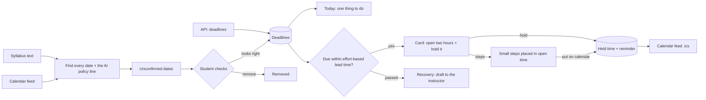

# Deadlines, plans and held time

Lead time grows with effort: `ceil(effort hours / 2) + 1` days, raised two days before that. Readings that pass get
no recovery note. Re-uploading a syllabus never duplicates a date.

## Verified by

<!-- verified-by:start -->
- [`apps/advocate/test/domain.test.ts`](../../apps/advocate/test/domain.test.ts) (14 test definitions)
- [`apps/advocate/test/phase1-extras.test.ts`](../../apps/advocate/test/phase1-extras.test.ts) (8 test definitions)
<!-- verified-by:end -->
