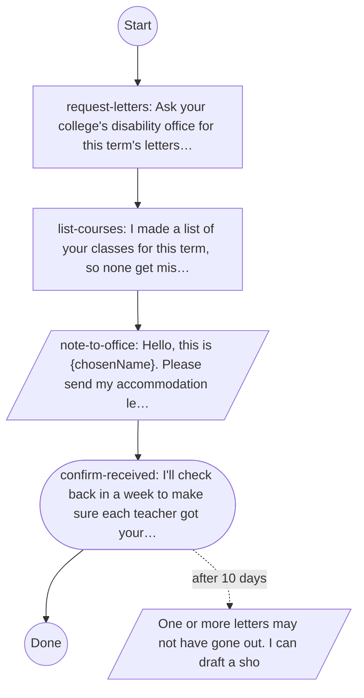
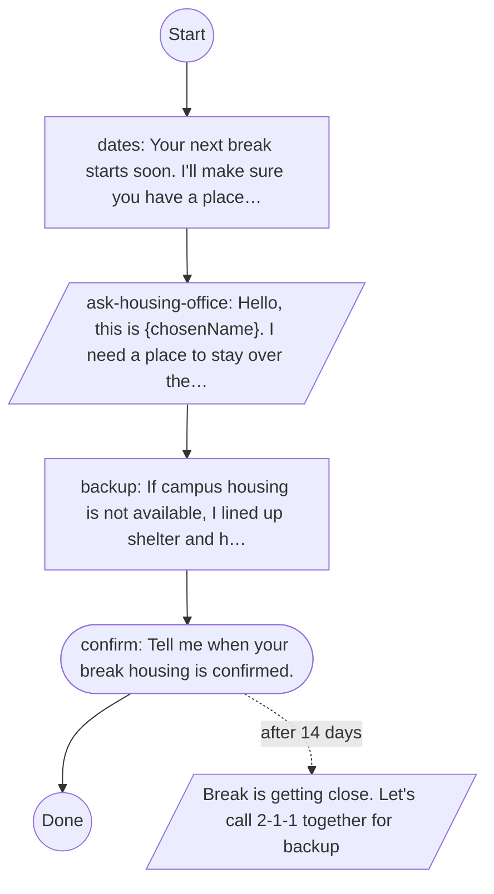
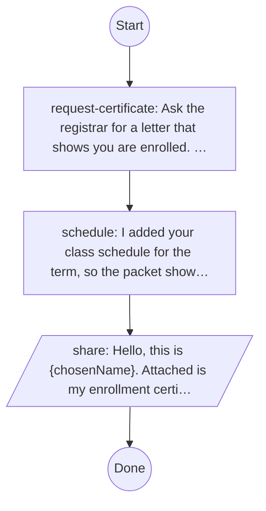
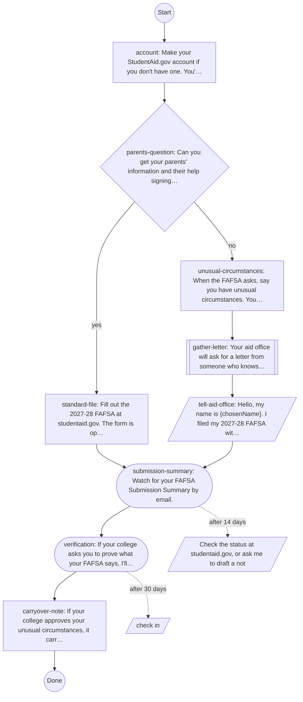
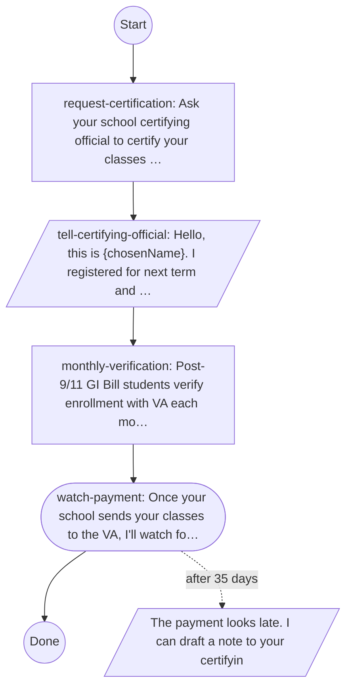
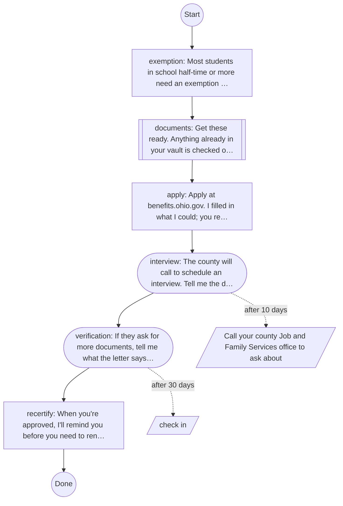

# Playbooks

<!-- generated by tools/docs.ts from control/playbooks/*.yaml; do not edit by hand -->

A playbook carries a student through a process that spans weeks and offices. Each is a declared file in the
control plane, needs a person's sign-off to change, reads only the grants it declares, and pauses in an explicit
unresolved state instead of guessing. Shapes: rectangle, a step to do; diamond, a question; stadium, waiting on
someone else; parallelogram, a message the student approves; double box, documents to gather.

## Your letters each term

Get approved accommodation letters to every instructor at the start of each term, without the student having to repeat the conversation.

Sources: <https://www2.ed.gov/about/offices/list/ocr/transition.html>. Grants: sealed disability_accommodations; profile chosenName, college. Journeys: persona-8c-accommodation-letters.

## Housing over breaks

Make sure a student has somewhere to stay over every break, arranged weeks ahead.

Sources: <https://sinclair.edu/student-life/wellness/resources/food-assistance/>. Grants: profile chosenName, college. Journeys: persona-2a-break-housing.

## Proof of enrollment packet

Assemble a dated proof-of-enrollment packet a student can hand to a parole officer, employer, landlord or caseworker.

Sources: <https://www.studentclearinghouse.org/>. Grants: profile chosenName, college. Journeys: persona-3a-parole-schedule-proof.

## FAFSA for 2027-28

File the 2027-28 FAFSA, including the path for students who cannot provide parent information, and carry it to an aid offer.

Sources: <https://abcnews4.com/news/nation-world/education-department-opens-2027-28-fafsa-early-marking-programs-earliest-launch>, <https://cdhe.colorado.gov/sites/highered/files/documents/Support_Guide_for_Unusual_Circumstances_F.pdf>. Grants: sealed family_circumstances; profile chosenName, college. Journeys: persona-11a-fafsa-without-parents.

## GI Bill each term

Keep a student's GI Bill tuition and housing allowance paid each term, catching problems before a payment is late.

Sources: <https://www.colorado.edu/veterans/2021/10/20/monthly-enrollment-verification>. Grants: sealed veteran_status; profile chosenName, college. Journeys: persona-4a-gi-bill-tracked.

## SNAP application in Ohio

Carry a student from a likely SNAP match to a decision, including the student exemption, the interview and verification.

Sources: <https://www.fna.usda.gov/snap/students>, <https://www.greenecountyohio.gov/279/Job-Family-Services>. Grants: profile chosenName, phone, zip, householdSize, monthlyGrossIncome, weeklyWorkHours. Journeys: persona-1b-bill-gap.

## Verified by

<!-- verified-by:start -->
- [`apps/advocate/test/playbooks.test.ts`](../../apps/advocate/test/playbooks.test.ts) (5 test definitions)
<!-- verified-by:end -->
