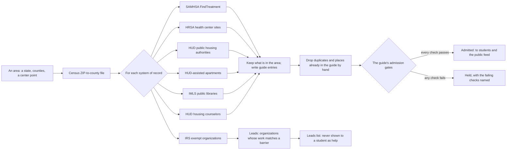
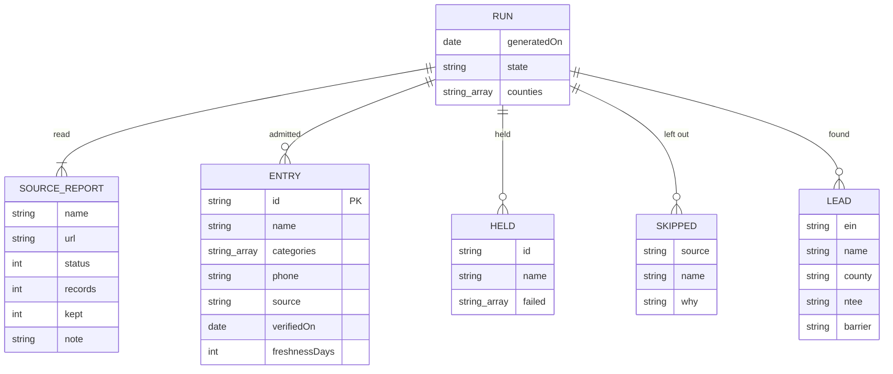

# The resource finder

Every county already has help that a student, a parent or a neighbor could use: health centers that charge less if you earn less, apartments where rent is based on income, treatment programs, libraries with free computers, housing counselors. Most of it is listed in a government system of record. Nobody reads all of those systems for one place, so every agency, college and congregation keeps its own short list, and each list goes stale on its own.

The resource finder reads those systems for an area and turns what it finds into checked guide entries. Anyone can run it for their own county. For Montgomery and Greene counties in Ohio, it finds about 200 entries the guide did not have by hand, from six federal systems, in a few minutes.



## What each system gives

| System of record | What it lists | Barrier | What an entry says, and only that |
|---|---|---|---|
| [SAMHSA FindTreatment](https://findtreatment.gov/) | Licensed mental health and substance use treatment | Mental health | The kind of treatment, and "charges less if you earn less" only when the record lists a sliding fee |
| [HRSA health center sites](https://findahealthcenter.hrsa.gov/) | Every federally funded community health center site | Health | That it sees you with or without insurance and has a sliding fee, which federal funding requires. School-based sites are left out, because they serve that school's students |
| [HUD public housing authorities](https://www.hud.gov/program_offices/public_indian_housing/pha/contacts) | The housing authority for each county | Housing | Public housing and vouchers. That wait lists open and close |
| [HUD-assisted apartments](https://resources.hud.gov/) | Buildings where HUD helps pay the rent | Housing | That rent is based on income, how many such units, and whether a building is for older adults or people with disabilities. Records with no phone are left out |
| [IMLS Public Libraries Survey](https://www.imls.gov/research-evaluation/surveys/public-libraries-survey-pls) | Every library branch | Phone and internet; school | Free computers, Wi-Fi and printing, and average weekly hours. Bookmobiles are left out |
| [HUD housing counselors](https://apps.hud.gov/offices/hsg/sfh/hcc/hcs.cfm) | HUD-approved housing counseling agencies | Housing; money | What a housing counselor helps with, and the languages offered |
| [IRS exempt organizations](https://www.irs.gov/charities-non-profits/exempt-organizations-business-master-file-extract-eo-bmf) | Every registered nonprofit and congregation | Leads only | Nothing to students. The IRS lists that an organization exists and its kind of work, not what it offers, when, or to whom |

An entry never claims what its record does not say. There are no hours unless published, and no eligibility beyond "call to ask who they serve" unless the program's own rules fix it. A sliding fee is claimed only where the record lists one, or where federal funding requires it.

## How an area is drawn

A county is drawn from the [Census 2020 ZIP-to-county relationship file](https://www.census.gov/geographies/reference-files/time-series/geo/relationship-files.2020.html). A ZIP code that crosses a county line belongs to the county holding most of its land. A source searched by distance, such as FindTreatment, is searched around the area's center and then narrowed to the area's ZIP codes. A source searched by city, such as HUD's counselor search, is asked about every city the IRS list places in the area.

## One place, or two

- **Two listings with the same phone and the same street number** are one place, and the first listing is kept.
- **Several sites of one organization under one name and one number** are each kept, named by town, or by town and street when two are in the same town. For example: "TCN Behavioral Health Services (Xenia)".
- **A place the guide already lists by hand** keeps its hand entry. A shared main number at another address is a different place, so every library branch is kept alongside the library's hotspot program.

## The gates

Every entry the finder writes goes through the same [admission gates](resource-guide.md#keeping-it-true-agents-and-their-governance) as an entry written by hand. A cited source, a real date, a stated freshness, barriers from the taxonomy, a way to reach it, a phone number that is a phone number, steps to use it, plain words, and an owner are all required. The finder is the scout that owns its entries: `control/scouts/found-dayton.yaml` is generated with each run. An entry that fails any check is held, with the failing checks named, and never reaches a student.



## Running it

The finder needs the network. It runs as a GitHub workflow, [Find resources](https://github.com/russlittle/ZTHR/actions/workflows/find-resources.yml), with inputs for the state, the counties (`Name:FIPS`) and a center point. To run it for another area, fork the repository, open the workflow and fill in your own area. The run's result is kept with the run.

```sh
npx tsx tools/find-resources.ts find --state OH --counties Montgomery:39113,Greene:39057 --center 39.7589,-84.1916 --out found
npx tsx tools/find-resources.ts catalog found/found.json dayton
```

The second command writes the run into the guide:

- the entries go into `apps/advocate/src/catalog/found/dayton.ts`;
- the leads go into `apps/advocate/src/catalog/found/dayton-leads.json`;
- the scout that owns the entries goes into `control/scouts/found-dayton.yaml`.

From there the entries reach students, the public feed and the page "Where help is missing", like any other entry.

## What it found for Montgomery and Greene

| System | Records read | Kept in the area |
|---|---:|---:|
| HUD-assisted apartments (Ohio) | 1,393 | 91 |
| SAMHSA FindTreatment (40 miles) | 216 | 79 |
| IMLS libraries (Ohio) | 784 | 33 |
| HRSA health center sites (Ohio) | 692 | 19 |
| HUD housing counselors | 6 | 6 |
| HUD public housing authorities (Ohio) | 75 | 2 |
| **Admitted** | | **202** |
| IRS exempt organizations (Ohio) | 77,808 | 1,101 leads |

Of what was read, 137 records were outside the area, 54 were school-based clinic sites, 5 had no phone number and 3 were bookmobiles. No entry was held by the gates.

## Where its limits are

- **Systems of record lag.** A clinic can close before its record changes. Each entry's freshness is 30 days (90 for libraries), and the guide's weekly verifier re-reads every entry's source.
- **Government systems miss most community help.** Faith pantries, clothing closets and mutual aid are rarely in a federal system. The IRS leads point at them, and a person or a later check turns a lead into an entry.
- **Some systems would not answer an automated reader:** the Head Start locator and county websites behind bot checks, among them. CareerOneStop's job center finder needs a key. Those stay with the hand entries for now.

## Evidence

| Check | What it holds | Where |
|---|---|---|
| Adapters (tests) | Each system's records, shaped as each system returned them, are kept or left out for the stated reason, and nothing is claimed that the record does not give | `finder.test.ts` |
| Admission (tests and gate) | Every entry an adapter writes passes the guide's gates. All 270 entries in the guide are admitted | `finder.test.ts`, `guide-admission` |
| One place, or two (tests) | The same phone and street is one place; a shared main number at two addresses is two; same-name sites are named by town and street | `finder.test.ts` |
| Names inside place names (tests) | A first name inside a guide place name (a clinic on Alex Road) is not reported as another student's name, and any other appearance still is | `finder.test.ts` |
| The feed | Every found entry is in the public feed with its system of record as its source | `guide-feed` |
