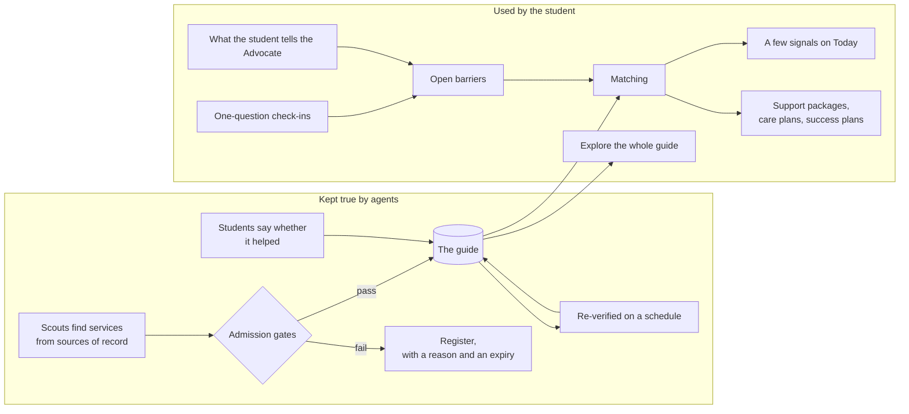
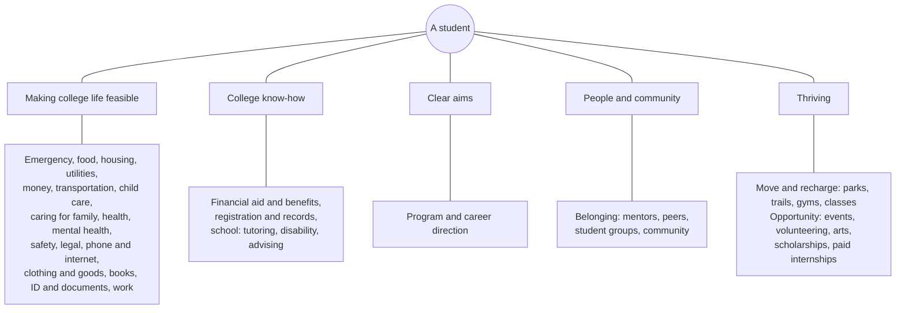
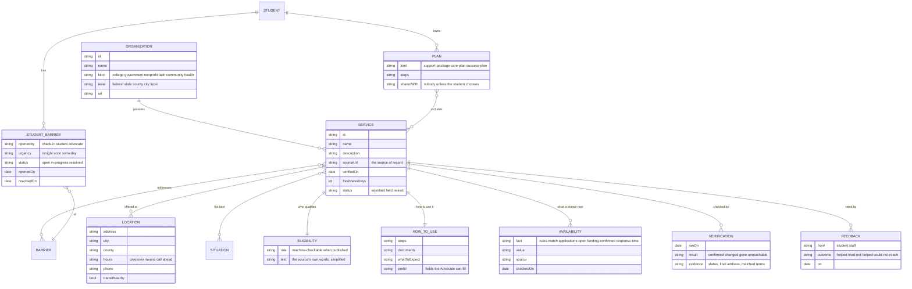
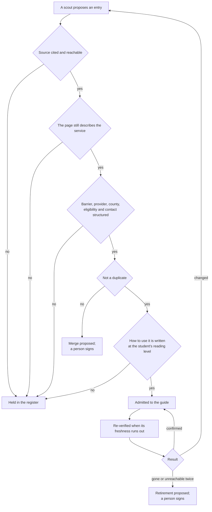
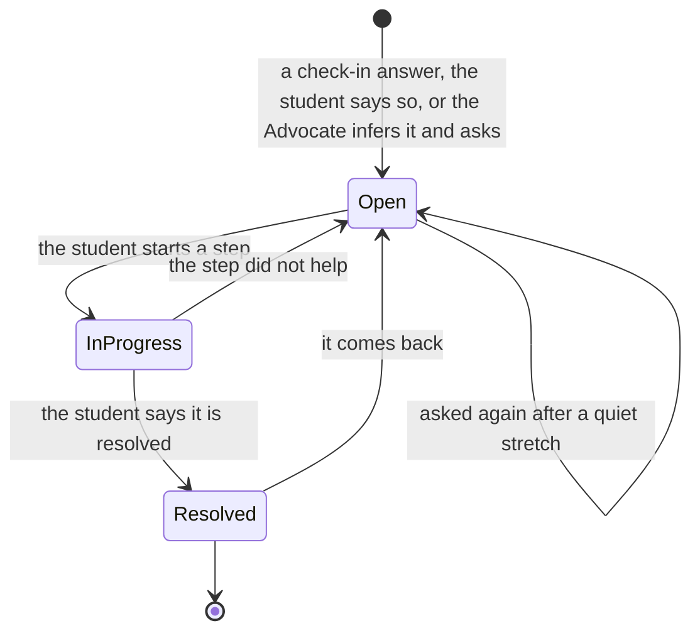

# Community resource guide

Staying in college often depends less on coursework than on rent, food, a ride, a sitter or a shut-off notice. A whole community stands ready to help with those: colleges, county and state offices, nonprofits, congregations and neighbors. But it is spread out, and no student can keep track of all of it. The resource guide gathers that community for a region into one place, organized by the barriers students face, kept true by agents, and turned by the Advocate into the few things worth doing now, so a student facing a hard week can see who is there for them.

The student has the whole guide. Nothing in it is hidden from them, and they can browse it by barrier, by kind of provider, by what is open now or near them. The Advocate's job is the opposite of a directory: to turn everything into a small number of clear signals, each with the next step already worked out.

## Who sees what

The guide's entries describe services, not people, so the guide is public: anyone can browse it without signing in, from a student to a counselor to a neighbor looking for help. Everything about a student (their barriers, their check-in answers, their plans and which resources they used) is private to that student and shared only by their choice.

## Barriers: the taxonomy

Research on community college students finds that support helps in four ways (Karp, CCRC): it makes college life feasible, it builds college know-how, it clarifies what a student is aiming for, and it connects them to people. The taxonomy is organized the same way, with a fifth domain for what helps a student thrive and not only survive: moving, being outdoors, events and opportunity. Some of the most useful supports are not obvious ones: a 2024 network meta-analysis of randomised trials in the BMJ (Noetel et al.) found walking or jogging, yoga and strength training eased depression, with structured programs doing better, and several institutional studies associate campus recreation use with higher grades and retention (association, not proof of cause). Each barrier is a service facet in the sense of the Open Eligibility taxonomy (Open Referral, CC BY-SA 3.0).

| Domain | Barrier | Covers | Example resources |
| --- | --- | --- | --- |
| Feasible | Emergency | No safe place tonight, no food today, a crisis | Shelter intake, 2-1-1, crisis lines, emergency food |
| Feasible | Food | Running short, no money for groceries, no way to cook | Campus pantries, food banks, SNAP, community meals |
| Feasible | Housing | Behind on rent, facing eviction, unstable, homeless | Rental assistance, eviction help, shelters, housing navigation |
| Feasible | Utilities | A shut-off notice, a high bill, heat in winter | HEAP and the winter crisis program, utility hardship funds |
| Feasible | Money | A bill coming due, a gap before payday, an emergency | College emergency grants, assistance funds, free tax preparation |
| Feasible | Transportation | No reliable way to class or work | Transit passes, ride programs, car repair funds |
| Feasible | Child care | No care for class or shifts | Child care subsidies, campus care, sick-child options |
| Feasible | Caring for family | Caring for a parent or relative | Caregiver support, respite |
| Feasible | Health | Care, prescriptions, insurance | Community health centers, Medicaid, sliding-scale care |
| Feasible | Mental health | Stress, anxiety, grief, a hard week | Campus counseling, community mental health, warmlines |
| Feasible | Safety | Not safe at home or in a relationship | Domestic violence services, protection orders, safe housing |
| Feasible | Legal | Eviction, records, benefits appeals | Legal aid, clinics, record sealing help |
| Feasible | Phone and internet | No phone, internet or computer | Lifeline, low-cost internet, device and hotspot loans |
| Feasible | Clothing and goods | Clothing, hygiene, furniture | Closets, free stores, congregations |
| Feasible | Books and supplies | Textbooks, calculators, course fees | Lending libraries, book grants |
| Feasible | ID and documents | No ID, birth certificate or Social Security card | ID help, vital records |
| Feasible | Work | Hours cut, a job lost, a better job | Workforce centers, job training, unemployment |
| Know-how | Aid and benefits | FAFSA, verification, an appeal, benefits a student qualifies for | Financial aid offices, benefits screening, FAFSA help |
| Know-how | School | Falling behind, a disability, tutoring, advising | Tutoring, disability services, advising, TRIO |
| Aims | Direction | Unsure about a program or a career | Career services, program exploration, job shadowing |
| People | Belonging | No one to ask, feeling alone, wanting people like me | Mentoring, student parent groups, veterans centers, affinity groups, community programs |
| Thriving | Move and recharge | Time to move, get outside, reset | Campus recreation, parks and trails, free fitness classes, community centers |
| Thriving | Opportunity | Something to look forward to, something to build | Free events, volunteering, arts and culture, library programs, scholarships, paid internships |

The research is equally clear that a one-time push at the start does not last, and that most students never hear of help that exists: in a 2026 CCRC fact sheet, 73% of two-year students faced at least one basic needs insecurity, yet 65% did not know about campus resources and half of those in need used none. The guide answers awareness; the Advocate answers the last mile.

Situations are not barriers; they change which resources fit: student parent, working student, veteran, former foster youth, first in family, returning adult, student with a disability, a student without a car.

## Providers

Every entry says who provides it, because a student deciding whether to walk in somewhere wants to know.

| Kind | Level | Examples |
| --- | --- | --- |
| College | The student's college | Pantry, emergency grant, counseling, disability services |
| Government | Federal, state, county, city | SNAP, HEAP, county job and family services, city programs |
| Nonprofit | Regional or local | Food banks, community action agencies, legal aid |
| Faith-based | Congregations and their charities | Food pantries, rent help, clothing closets |
| Community | Neighborhood groups, mutual aid | Free stores, community fridges, ride shares |
| Health | Hospitals and clinics | Community health centers, behavioral health |

Faith-based providers are listed with what they ask of the people they serve, stated plainly: whether help depends on attending a service, and whether it is open to anyone.

## The data

The entries follow the Open Referral Human Services Data Specification (organization, service, location, schedule, eligibility), extended with what the Advocate needs to do the legwork and what the agents need to keep it true.

## Keeping it true: agents and their governance

The guide is maintained the way the application is built: agents do the work, and gates decide what is admitted. A person signs only destructive changes.

| Agent | Does | Held to |
| --- | --- | --- |
| Scout | Finds services for one county and one barrier from sources of record: agency pages, college pages, 2-1-1 listings, published directories | Cites a source for every fact; a precision datum (the share of its entries that verify) below which it retires and its entries are held |
| Verifier | Re-reads each entry's source on its freshness schedule | Records what it saw: status, final address, the terms it matched |
| Editor | Writes how to use it: steps, documents, what to expect, in plain language | The reading-level gate; never adds a fact the source does not state |
| Curator | Merges duplicates, assembles support packages, retires what is gone | Merges and removals wait for a person's signature |
| Auditor | Samples admitted entries and checks them by an independent route (a second source, a phone listing) | Its sample results set each scout's precision |

An entry that cannot be verified is never silently dropped and never shown as current: it goes to the register with a reason and an expiry, and the student sees it marked "not confirmed recently, call first".

## What is known, said separately

A program can exist, match a student and still not help in time. The guide keeps four facts apart, each with its source and the day it was checked, and says "not known" when nobody publishes it.

| Fact | Example | Where it comes from |
| --- | --- | --- |
| The rules match | "You meet the published income rule" | The eligibility engine, from what the student told the Advocate |
| Applications are open | "Taking applications this month" | The provider's page or listing |
| Funding or appointments are available | "Appointments this week" or "not known" | Only a provider or a partner college can confirm this |
| How long it takes | "Usually decides within 10 days" | The provider, or what other students reported |

## How good it is: feedback

After a student uses a resource, the Advocate asks one question: did it help? The answers (helped, tried and it did not help, could not reach them) become the entry's record, shown as plain counts ("helped 14 of 19 students who tried, this term") once there are enough to mean something. A resource that rarely helps is flagged to the curator, not hidden, because it may still be the only one.

## Check-ins: finding barriers without a form

Every so often, at the rhythm the student chose, the Advocate asks one question. A student can skip any question or turn check-ins off.

| Barrier | Question | Source |
| --- | --- | --- |
| Food | Within the past 12 months, did you worry that your food would run out before you got money to buy more? | Hunger Vital Sign (Hager et al., 2010), free to use with citation |
| Housing | What is your living situation today: a steady place, a place but worried about losing it, or no steady place? | Adapted from the CMS Accountable Health Communities screening tool; reuse needs the item author's citation and notice, registered until cleared |
| Housing, tonight | Do you have a safe place to stay tonight? | Written for the Advocate; a "no" is an emergency |
| Utilities | Has a utility company threatened to shut off your electric, gas or water? | Adapted from the CMS screening tool, as above |
| Transportation | Has not having a reliable ride kept you from class or work? | Adapted from the CMS screening tool, as above |
| Money | Is a bill coming up that you are worried about? | Written for the Advocate |

A "yes" opens a barrier. It stays open, and the Advocate includes it in every recommendation and plan, until the student says it is resolved. If the student goes quiet, the Advocate asks again later, gently; a barrier never closes on its own.

"No safe place tonight" skips the queue: the answer is shelter intake, 2-1-1 and the crisis line, at the top of the screen, in plain words, with the next step for tomorrow after that.

Barrier answers are sealed like the Advocate's other sensitive fields: never shown to an advisor or a college unless the student shares them, and followed by the planted-marker trace on every build.

## From everything to a few signals

Matching scores each admitted service against each open barrier, and the Advocate shows at most three signals on Today, each with the step already worked out. The order is:

1. **Urgency.** Tonight before this week; a shut-off date before a someday.
2. **Deadlines.** An application that closes before a rent due date.
3. **Fit.** The rules match, applications are open, and nothing known rules it out.
4. **Reach.** Open now, near the student or on a bus line, at a time the student is free.
5. **Record.** How often it has helped students like this one.

Everything else stays one tap away, in the guide, filtered to the student's open barriers.

## Packages and plans

The guide's entries combine into three kinds of plan, each owned by the student.

| Plan | Scope | Example |
| --- | --- | --- |
| Support package | One barrier, the usual combination of help | Short on rent: the college emergency grant, county emergency assistance, 2-1-1, and how to ask the landlord for time |
| Care plan | This student's open barriers together, with steps and dates | Rent short and the car is down: the grant application first, a transit pass to get there, a reminder when a decision is due |
| Success plan | The term: classes, work, care and support together | Shared with an advisor only if the student chooses, and only the parts the student picks |

Each step in a plan is followed to its end: applied, missing information resolved, decided, help received, or another route taken.

## What the Advocate watches

Alongside barriers, the Advocate keeps the signals that research ties most closely to finishing (Jenkins and Bailey, *Early Momentum Metrics*, CCRC):

| Signal | The measure | Why it matters |
| --- | --- | --- |
| Credit momentum | 15 credits attempted in the first term, or 30 in the first year | Students at 15 were more likely to earn a degree than those at 12 |
| Gateway momentum | College-level math and English passed in the first year | In Tennessee, 48% of those who passed both earned a credential within six years, against 18% |
| Program momentum | 9 credits in the student's program in the first year | 40% against 16% completing within six years, in the same data |
| Standing and aid progress | GPA, pace and the maximum timeframe | Losing aid is a common way to stop out |
| Critical moments | Registering for the second year, drifting from a program, 15 credits from finishing | Moments CCRC's advising research names for a personal check-in |

These are for the student first: a momentum line on the School screen, and a single nudge at a critical moment, never a score held over them.

## How it is delivered: the research behind the choices

CCRC's framework for advising (sustained, strategic, integrated, proactive, personalized) and RAND's study of basic needs support set the rules the Advocate keeps:

| Principle | What the Advocate does |
| --- | --- |
| Sustained, not one push at entry | Check-ins and barrier follow-up run all term, at the rhythm the student set |
| Proactive | It brings the right help to the student before they ask, at critical moments |
| Personalized | Signals come from this student's barriers, situation, schedule and record |
| Integrated | Campus and community help in one place; a handoff to the right office carries the context the student chose to share |
| Do not over-message | At most three signals; one check-in at a time; "not today" is respected |
| Tiered responses | Tonight gets an emergency route; this week gets a step; someday waits in the guide |
| Define closure | A barrier closes only when the student says it is resolved; every step is followed to its end |
| Streamlined intake | Forms are pre-filled from what the student already told the Advocate |
| Data-informed | Service use is linked to outcomes; feedback is asked after every use |

## Beyond a directory

- **Benefits check.** Many students qualify for SNAP through a student exemption (working 20 hours, work-study, a child under six) and never apply; in California only 26% of eligible community college students received it. The Advocate checks the exemptions against what it knows and prepares the application.
- **Warm handoffs.** Instead of a phone number, a prepared message to a named office, sent only with the student's approval, carrying only what the student chose to include.
- **Seasonal help.** The winter crisis utility program, free tax preparation and the earned income credit in tax season, summer meal programs, the second-year registration window: the guide knows when each matters and the Advocate brings it up then.
- **Coverage gaps.** The QA agents publish which barriers have little or no help in each county, by provider kind. For a region, that is a map of where the safety net is thin; for a funder, where to put money.
- **Peer record.** After enough students have used a resource, it shows how often it helped ("helped 14 of 19 students who tried, this term"), so the next student knows what to expect.
- **Well-being that is not an emergency.** When a student says it has been a hard week, the Advocate can offer a walk on a nearby trail between classes, a free yoga class or a park event alongside counseling, because movement helps and costs nothing, and it never replaces a crisis route.
- **Community connection.** Belonging is part of the guide: mentoring, student parent groups, veterans centers, congregations and community programs that welcome students, not only services for emergencies.

## The public feed

The guide is offered as a public benefit: any app, college, library, congregation or agency can take it as a feed instead of doing the legwork themselves. The feed follows the Open Referral Human Services Data Specification, carries each entry's source, the day it was verified and its verification record, and is free to use with attribution. It holds services, never students.

## Evidence

| Gate or record | Shows |
| --- | --- |
| Resource admission | Every admitted entry has a cited, reachable source; structured barrier, provider, county and eligibility; and how-to-use text at the reading level |
| Link and content QA | Each verification run, published: what was checked, what was found, what changed |
| Freshness | No entry is shown as current past its freshness; a ratchet on the share of entries verified on time |
| Precision audit | Each scout's sampled precision against its datum |
| Check-in fidelity | Each question matches its cited source's wording, or is marked as written for the Advocate |
| Barrier lifecycle | No sequence of answers closes a barrier the student did not resolve |
| Sensitive trace | Barrier answers never reach an advisor, a college or a log unless the student shares them |
| Matching journeys | Locked journeys for compound situations: a student short on rent, without a ride and with a sick child gets the right three signals |
| Coverage | Each barrier in each county has help from at least one kind of provider, or a published gap |
| Feed | The public feed validates against its published schema and carries every entry's source and verification |

## Sources

- Karp, M. M. (2011). *Toward a New Understanding of Non-Academic Student Support: Four Mechanisms Encouraging Positive Student Outcomes in the Community College*. Community College Research Center.
- Jenkins, D., and Bailey, T. (2017). *Early Momentum Metrics: Why They Matter for College Improvement*. Community College Research Center.
- Karp, M. M., Ackerson, S., Cheng, I., Cocatre-Zilgien, E., Costelloe, S., Freeman, B., Lemire, S., Linderman, D., McFarlane, B., Moulton, S., O'Shea, J., Porowski, A., and Richburg-Hayes, L. (2021). *Effective Advising for Postsecondary Students: A Practice Guide*; and CCRC's *A Framework for Advising Reform* (2020).
- Community College Research Center (2026). *Basic Needs Supports* fact sheet.
- RAND Corporation (2025). *The Six Core Features of Student Basic Needs Support in Community Colleges*.
- Billioux, A., et al. (2017). *Standardized Screening for Health-Related Social Needs in Clinical Settings: The Accountable Health Communities Screening Tool*. National Academy of Medicine.
- Noetel, M., et al. (2024). Effect of exercise for depression: systematic review and network meta-analysis of randomised controlled trials. *BMJ* 384:e075847.
- Hager, E. R., et al. (2010). Development and validity of a 2-item screen to identify families at risk for food insecurity. *Pediatrics* 126(1).
- Open Referral. *Human Services Data Specification*; Open Eligibility taxonomy.

