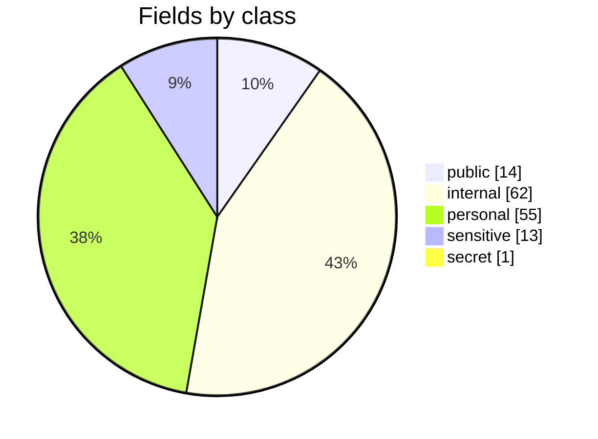
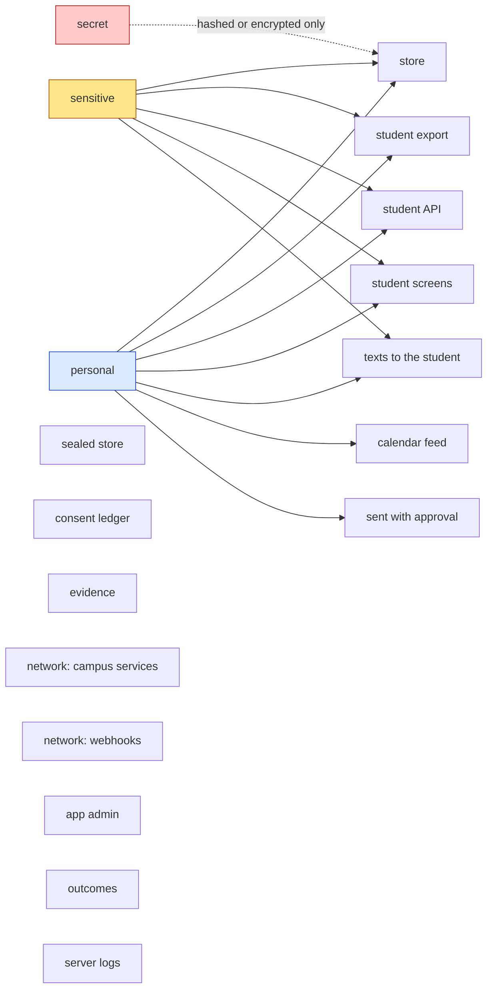
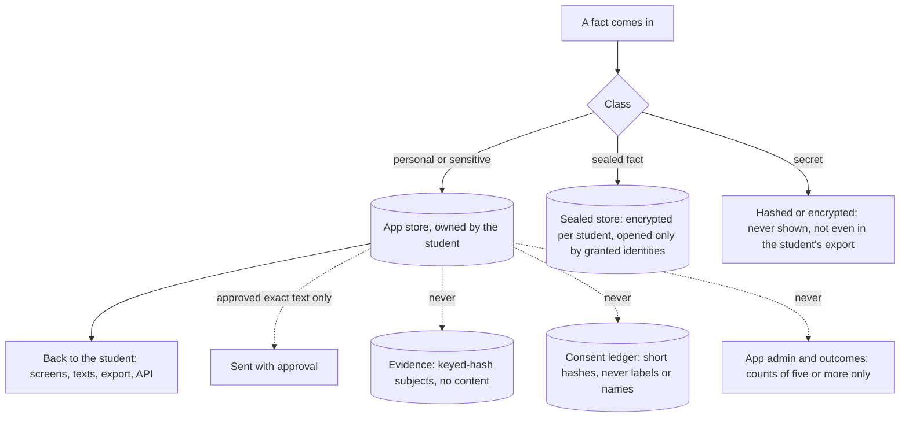
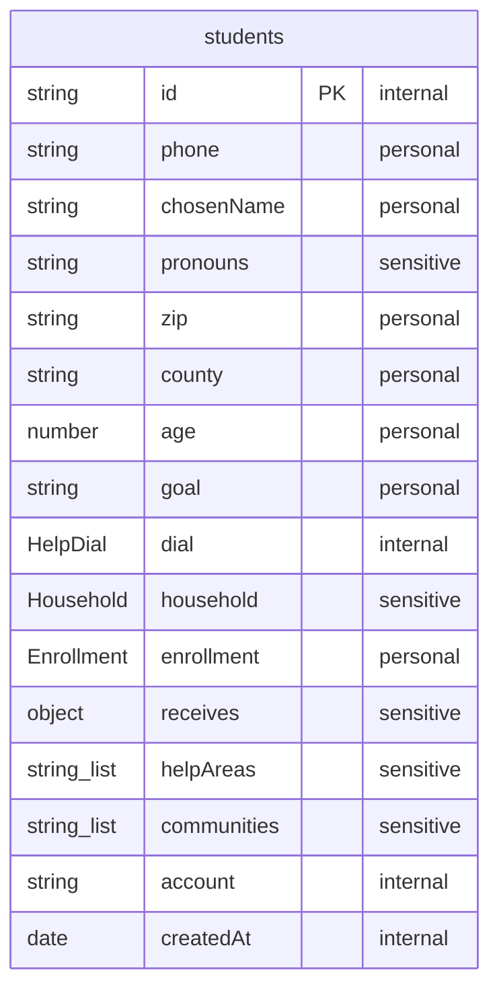
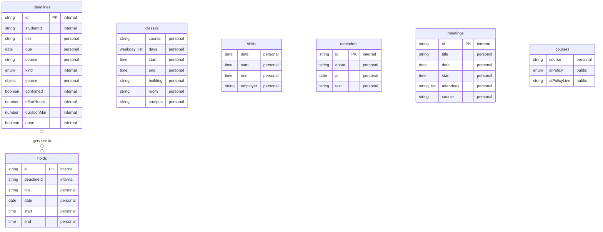
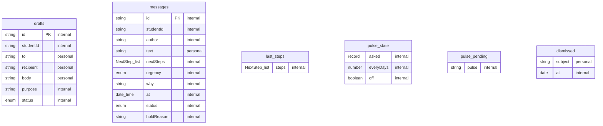
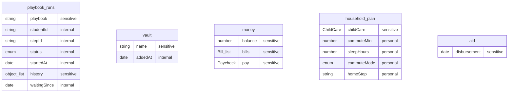
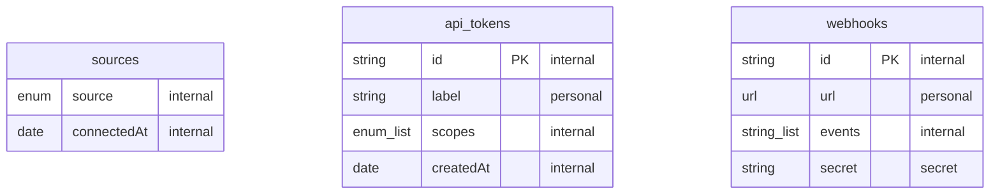
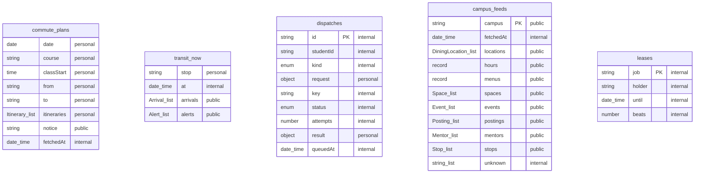

# Sensitive data

<!-- generated by tools/sensitive.ts from apps/advocate/src/domain/schema.ts and the trace policy; do not edit by hand -->

Every field the Advocate keeps is classified, and every build proves where the personal, sensitive and secret ones
actually go. A unique marker is planted in each such field; a student then uses the app by text, on the web,
through the API, with a mentor introduction sent and a webhook registered; and every place data can land is
searched for every marker. A marker found anywhere its class may not go fails the `sensitive-data` gate, naming
the field and the place. The latest run is on the factory console's Sensitive data trace page.

## The classes

| Class | Means | Fields |
| --- | --- | --- |
| public | Published facts anyone may read | 14 |
| internal | Ids, times, statuses and settings that say nothing about the student alone | 62 |
| personal | Identifies or describes the student: name, phone, schedule, what they wrote | 55 |
| sensitive | Special-category: money, benefits, family, identity, which help they need, sealed facts | 13 |
| secret | Credentials: stored only hashed or encrypted, never shown | 1 |

## Where each class may go

| Place | Personal | Sensitive | Secret |
| --- | --- | --- | --- |
| store | yes | yes | no |
| sealed store | no | no | no |
| consent ledger | no | no | no |
| evidence | no | no | no |
| student export | yes | yes | no |
| student API | yes | yes | no |
| student screens | yes | yes | no |
| texts to the student | yes | yes | no |
| calendar feed | yes | no | no |
| sent with approval | yes | no | no |
| network: campus services | no | no | no |
| network: webhooks | no | no | no |
| app admin | no | no | no |
| outcomes | no | no | no |
| server logs | no | no | no |

A field may declare one more place for itself, with a reason: the student's first name and the note they approved
go to the mentor platform; their class-site token goes to the class site; their webhook address receives webhooks.

## How it stays out

## Personal, sensitive and secret fields

| Field | Class | Note |
| --- | --- | --- |
| `students.phone` | personal |  |
| `students.chosenName` | personal |  |
| `students.pronouns` | sensitive |  |
| `students.zip` | personal |  |
| `students.county` | personal |  |
| `students.age` | personal |  |
| `students.goal` | personal |  |
| `students.household` | sensitive | size, income, children |
| `students.enrollment` | personal | college, credits, work hours |
| `students.receives` | sensitive | benefits already received |
| `students.helpAreas` | sensitive |  |
| `students.communities` | sensitive | chosen, never inferred |
| `deadlines.title` | personal |  |
| `deadlines.due` | personal |  |
| `deadlines.course` | personal |  |
| `deadlines.source` | personal | where it was found, with the line |
| `classes.course` | personal |  |
| `classes.days` | personal |  |
| `classes.start` | personal |  |
| `classes.end` | personal |  |
| `classes.building` | personal |  |
| `classes.room` | personal |  |
| `classes.campus` | personal |  |
| `shifts.date` | personal |  |
| `shifts.start` | personal |  |
| `shifts.end` | personal |  |
| `shifts.employer` | personal |  |
| `holds.title` | personal |  |
| `holds.date` | personal |  |
| `holds.start` | personal |  |
| `holds.end` | personal |  |
| `reminders.about` | personal |  |
| `reminders.at` | personal |  |
| `reminders.text` | personal |  |
| `drafts.to` | personal |  |
| `drafts.recipient` | personal |  |
| `drafts.body` | personal |  |
| `messages.text` | personal |  |
| `playbook_runs.playbook` | sensitive |  |
| `playbook_runs.history` | sensitive |  |
| `api_tokens.label` | personal |  |
| `webhooks.url` | personal |  |
| `webhooks.secret` | secret | signs each delivery |
| `vault.name` | sensitive |  |
| `money.balance` | sensitive |  |
| `money.bills` | sensitive |  |
| `money.pay` | sensitive |  |
| `household_plan.childCare` | sensitive |  |
| `household_plan.commuteMin` | personal |  |
| `household_plan.sleepHours` | personal |  |
| `household_plan.commuteMode` | personal | bus, car, walk |
| `household_plan.homeStop` | personal | transit stop id the student picked |
| `commute_plans.date` | personal |  |
| `commute_plans.course` | personal |  |
| `commute_plans.classStart` | personal |  |
| `commute_plans.from` | personal | stop id |
| `commute_plans.to` | personal | stop id |
| `commute_plans.itineraries` | personal |  |
| `transit_now.stop` | personal |  |
| `dispatches.request` | personal |  |
| `dispatches.result` | personal |  |
| `meetings.title` | personal |  |
| `meetings.date` | personal |  |
| `meetings.start` | personal |  |
| `meetings.attendees` | personal |  |
| `meetings.course` | personal |  |
| `courses.course` | personal |  |
| `dismissed.subject` | personal |  |
| `aid.disbursement` | sensitive |  |

## Sealed facts

| Fact | Class | Why it is sealed |
| --- | --- | --- |
| `justice_involvement` | sensitive | Justice history; used only for the fair-chance path when the student asks. |
| `foster_care_history` | sensitive | Foster care history; opens foster-youth aid. |
| `class_site_token` | secret | The student's class-site login token; granted only to the class-site sync. |
| `doc:<keyed hash of the name>` | sensitive | The contents of documents the student keeps; the name itself stays out of the sealed store and the ledger. |

## The record, by sensitivity

Each field's class is shown beside it. A collection is as sensitive as its most sensitive field.

| Collection | Most sensitive field |
| --- | --- |
| `students` | sensitive |
| `deadlines` | personal |
| `classes` | personal |
| `shifts` | personal |
| `holds` | personal |
| `reminders` | personal |
| `drafts` | personal |
| `messages` | personal |
| `last_steps` | internal |
| `playbook_runs` | sensitive |
| `pulse_state` | internal |
| `pulse_pending` | internal |
| `sources` | internal |
| `api_tokens` | personal |
| `webhooks` | secret |
| `vault` | sensitive |
| `money` | sensitive |
| `household_plan` | sensitive |
| `commute_plans` | personal |
| `transit_now` | personal |
| `dispatches` | personal |
| `campus_feeds` | internal |
| `leases` | internal |
| `meetings` | personal |
| `courses` | personal |
| `dismissed` | personal |
| `aid` | sensitive |

### student

### schedule

### conversation

### help and money

### connections

### campus

## Verified by

<!-- verified-by:start -->
- [`apps/advocate/test/sensitive.test.ts`](../../apps/advocate/test/sensitive.test.ts) (7 test definitions)
<!-- verified-by:end -->
