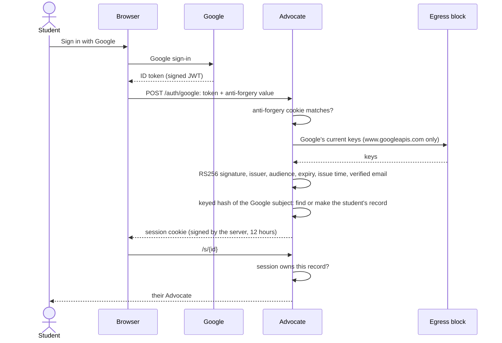

# Signing in

In the demonstration anyone can open the twelve students. In production, a student signs in with Google, and
every page of their Advocate needs their own session. The admin needs an email on the admin list. The server
trusts nothing in a Google token until it has checked all of it.

| Refused | Why |
| --- | --- |
| Any algorithm but RS256, including `none` and HS256 | Algorithm confusion is a classic forgery |
| A key id Google has not published | Only Google's keys sign |
| A token for another app, another issuer, expired or from the future | The token must be for this app, now |
| An unverified email | The account must be real |
| A missing or mismatched anti-forgery value | Stops sign-in forgery from another site |
| Google's keys unreachable | Refuse rather than trust |

The record stores only a keyed hash of the Google subject; the session carries that hash and a hash of the email,
nothing else.

## Verified by

<!-- verified-by:start -->
- [`apps/advocate/test/auth.test.ts`](../../apps/advocate/test/auth.test.ts) (15 test definitions)
<!-- verified-by:end -->
