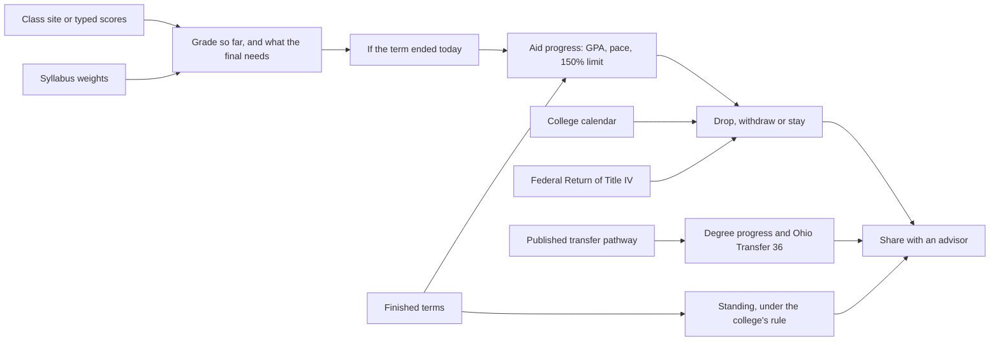
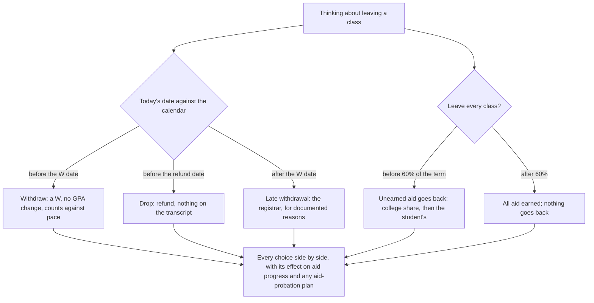
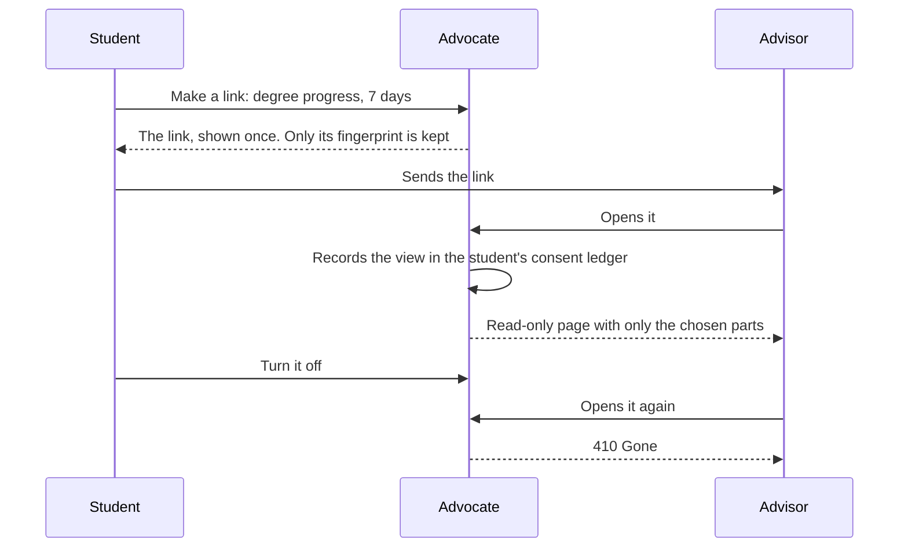
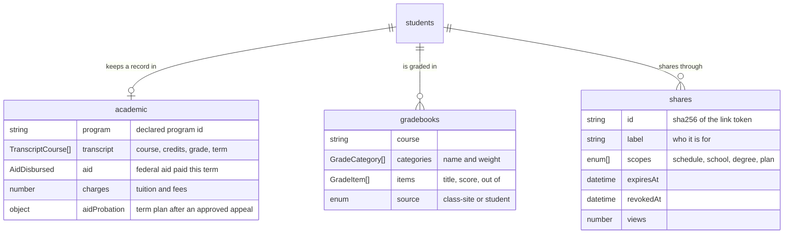

# Staying enrolled: grades, standing, aid progress and the choice to leave a class

Most students who leave college don't leave because of one bad grade. They leave over a chain of events: a class
going badly, a withdrawal that looks safe, a financial aid rule nobody explained, then a bill for aid that has to
go back. Each rule in that chain is published, but each lives in a different office's policy. This part of the
Advocate puts them in one place, applies them to the student's own record, and shows what each choice would do
before the student makes it.

Every figure comes from a published rule. No model decides any of them, and the college and the aid office still
make the official decisions.

## The rules, and where each comes from

| Rule | Source | How it is applied |
| --- | --- | --- |
| Grade so far | The class syllabus | Each category's percent on graded work, weighted by the syllabus and spread over the categories with grades so far. The 90/80/70/60 scale unless the syllabus sets its own. |
| What the final needs | The same weights | Solved exactly for each letter, holding the other categories where they are. A letter that would need more than 100% is said to be out of reach. |
| GPA | The college's grade points | A=4 through F=0 over graded credits. W, I, P and transfer credit carry no points; for a repeated course the latest grade counts. |
| Academic standing | [Sinclair: academic status](https://www.sinclair.edu/services/welcome/academic-advising/academic-status/), [Wright State: Policy 3350](https://policy.wright.edu/3350) | Sinclair counts consecutive terms under a 2.0 term GPA: Intervention, Probation, Dismissal. Wright State places a student on probation under a 2.0 cumulative GPA after 12 attempted hours. |
| Aid progress (SAP) | [34 CFR 668.34](https://www.law.cornell.edu/cfr/text/34/668.34), [Sinclair](https://www.sinclair.edu/services/welcome/finaid/financial-aid-policies/), [Wright State](https://wright.edu/raiderconnect/financial-aid/satisfactory-academic-progress) | A 2.0 GPA; pace of 66.67% (Sinclair) or 67% (Wright State), with W, F, I, repeats and transfer counted as attempted; at most 150% of the program's credits attempted. |
| Drop and withdrawal dates | Each college's academic calendar | Wright State Fall 2026: 100% refund through September 4, a W through October 23. Sinclair: a 100% refund through the eighth calendar day; its Fall 2026 dates were not available from a public source, so they are shown as not known. |
| Aid returned on withdrawal | [Federal Student Aid Handbook, Volume 5](https://fsapartners.ed.gov/knowledge-center/fsa-handbook/2025-2026/vol5/ch3-return-title-iv-r2t4-funds-case-studies-part-1), 34 CFR 668.22 | Aid earned in proportion to the days completed, with breaks of five days or more left out; all of it earned after 60%. The college returns the lesser of unearned aid and unearned charges. Loans are repaid on the note's terms. Grants are owed only above the 50% protection and $50. |
| Degree progress | [Ohio's Sinclair sociology pathway](https://dam.assets.ohio.gov/image/upload/transfercredit.ohio.gov/files/transfer/pathways/SNCL_Sociology.pdf), [Ohio Transfer 36](https://www.starkstate.edu/admissions/ohiotransfer36/) | Passed courses counted once, in the first area that lists them. In-progress courses shown separately. The finish term comes from the remaining credits at the student's current load, without summers. |

When a policy doesn't say something, the Advocate says so rather than filling the gap. Sinclair's public aid page
doesn't state when progress is evaluated, and its Fall 2026 drop dates weren't published in a form that could be
read. Both are shown as not known, and the student is sent to the office that knows.

## Drop, withdraw or stay

The Advocate never tells a student which choice to make. It shows each one with today's consequences, and offers to
share the comparison with an advisor.

## Sharing with an advisor

Early alert has always run from the college to the student. This runs the other way: the student decides an
advisor should see something, and for how long.

- **Only what was chosen.** The scopes are the week, classes and standing, degree progress, and the plan. Each one
  draws only its own section, and sealed facts never appear in any of them.
- **Nothing to steal.** The link is shown once and never stored; only its SHA-256 fingerprint is kept. It doesn't
  appear in messages, exports or logs.
- **Off means off.** A turned-off or expired link answers 410, and deleting the account ends every link.
- **The student sees each view.** Every opening is an entry in the student's hash-chained consent ledger.

## Data

Transcripts, scores, aid amounts and probation plans are classified as sensitive. The sensitive-data trace plants
a marker in each of them and checks every place data can land.

## How it is proven

| Proof | What it checks |
| --- | --- |
| `r2t4-oracle` gate | Reproduces the Handbook's Case 2 to the cent, the 60% rule and the $50 rule. It is proven able to fail by a planted count that keeps breaks in the term and a planted estimate without grant protection. |
| `sap-oracle` gate | Tests each college exactly at its thresholds: pace at and just under the line, GPA, the 150% limit, a W counted as attempted, and transfer credit counted as earned. It is proven able to fail by a planted measure that drops W and a planted pace rounded to a whole percent. |
| `share-scope` gate | Opens five scope sets and confirms each shows only its parts, never a sealed fact, never a stored link, and that off and expired links are gone. It is proven able to fail by three planted defects. |
| Journeys `p5-*` | Five locked cards. The final-exam card checks every figure against an exact computation that finds the needed score by trying every score. The drop card checks passed deadlines, the 60% point and every stated date against the college's declared calendar. |
| `school.test.ts`, `academics.test.ts` | The rules at their edges, typed scores, every screen for every kind of student, and sharing's scope, revocation, expiry and ownership. |
