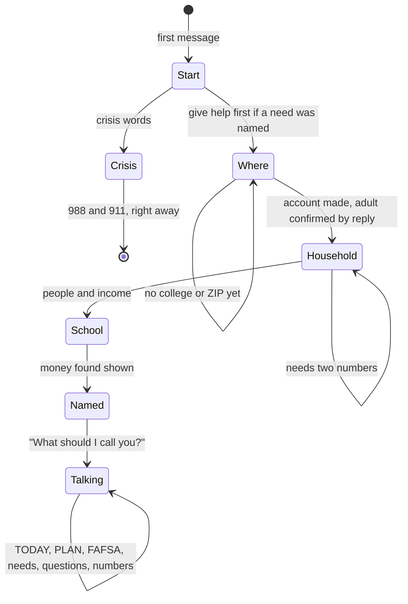

# Starting by text

A student can start with any message. If it names a need, they get help first and questions after. The account is
made at the second reply; replying confirms the student is 18 or older, and that confirmation is in the consent
ledger. Crisis words at any point go straight to the safety reply.

Spanish is detected from the first message and the whole start runs in Spanish.

## Verified by

<!-- verified-by:start -->
- [`apps/advocate/test/advocate.test.ts`](../../apps/advocate/test/advocate.test.ts) (7 test definitions)
<!-- verified-by:end -->
