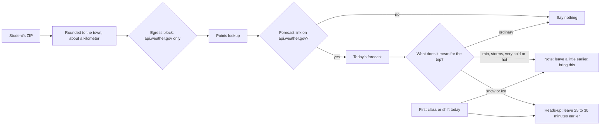

# Weather and roads

On a day when the weather changes how a student gets to class or work, the Advocate says so before they leave:
what is coming, how much earlier to leave for the first class or shift, and what to bring. On ordinary days it
says nothing.

| Weather | Severity | Leave earlier |
| --- | --- | --- |
| Ice, freezing rain, sleet | plan around it | 30 minutes |
| Snow, likely | plan around it | 25 minutes |
| Storms or heavy rain | worth a note | 10 to 15 minutes |
| 10 degrees or colder | worth a note | 10 minutes |
| 95 degrees or hotter | worth a note | bring water |
| Anything else | nothing said | |

Nothing about the student leaves: only the town's coordinates. If the weather service is down, slow or points
anywhere unexpected, the Advocate says nothing rather than guess.

## Verified by

<!-- verified-by:start -->
- [`apps/advocate/test/weather.test.ts`](../../apps/advocate/test/weather.test.ts) (10 test definitions)
<!-- verified-by:end -->
