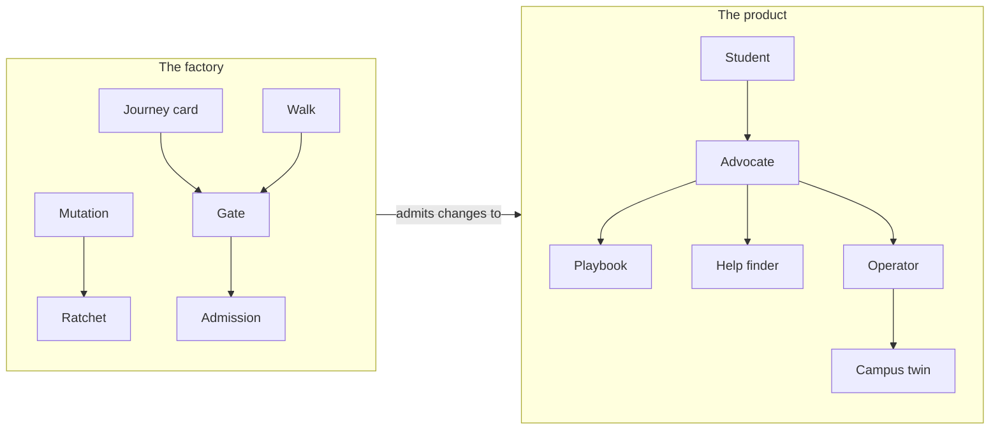

# Glossary

The words this project uses, in plain terms. Product words first, then the factory's.

## The product

| Term | Meaning |
| --- | --- |
| Advocate | The student-facing team: one voice in front of specialist agents (planner, money coach, help finder, week planner). |
| Approval | A student's yes to the exact words of a message. Nothing leaves on their behalf without one. |
| Catalog | The verified list of programs and services, each with a source and the date it was last checked. |
| Consent ledger | An append-only, hash-chained record of every grant, revoke, approval, export and deletion. |
| Depth | How much the Advocate says: brief, standard or walk-me-through. |
| Dispatch | A write the operator sends to another system for the student, such as a room booking. Sent is not done: it is confirmed by looking it up. |
| Draft | A message the Advocate wrote for the student to send, waiting for their approval. |
| Fair-chance | Jobs and programs open to people with a justice history, offered only when the student asks. |
| Freshness | How long a catalog entry may go unchecked before it is no longer offered as current. |
| Hold | Time on the student's calendar the Advocate keeps for a piece of work. Also, a job the operator did not run, with what the student loses by it. |
| Idempotency key | A key sent with a write so that sending it twice has the effect of sending it once. |
| Lease | A short claim on a background job, renewed by heartbeats, so two operators never run it at once. |
| Next step | The button every message offers; a message without one fails the tone gate. |
| Operator | The background worker that keeps campus feeds fresh, plans bus trips, syncs class sites and carries out dispatches. |
| Playbook | A long process (FAFSA, SNAP recertification, GI Bill) declared as steps the Advocate walks a student through. |
| Pulse | A quick yes-or-no question, asked rarely, that the student can turn off. |
| Reading grade | How hard text is to read, by the Flesch-Kincaid formula; every message is held to the student's chosen level. |
| Scout | A declared check that keeps one slice of the catalog current, drafted by the builder and admitted by the factory. |
| Sealed fact | A sensitive fact kept encrypted with the student's own key and opened only by identities they granted. |
| Sensitivity class | How sensitive a field is: public, internal, personal, sensitive or secret. |
| Small-cell suppression | Never showing a number about fewer than five students. |
| Twin | A stand-in for a service the project does not own, held to the same contract as the real one. Campus twins are synthetic APIs for dining, transit, rooms, jobs and class sites. |

## The factory

| Term | Meaning |
| --- | --- |
| Admission | The factory accepting a change because every required check passed. People sign only destructive changes. |
| Block | A reusable part with one purpose, its own tests and mutation floor, and a page saying what to use it for and what not. |
| Canary | A unique, harmless marker planted in a field to trace where that field's data goes. |
| Certificate | A record that a phase passed every check at one commit. A report from another commit cannot certify it. |
| Contract | The schema every implementation of a service must meet, checked by probes. |
| Determinism ladder | Solve with rules first, computation second, a model last, and only inside deterministic checks. |
| Evidence | The pseudonymous, append-only record of what the factory and the product did. |
| Fixpoint | The point where a walk finds no new state: every button from every state has been tried. |
| Gate | A check that can block a change. A gate counts only after planted defects make it fail. |
| Held out | Test phrases no rule may contain, so rules are never written against their own exam. |
| Journey card | A student's goal in plain words, with outcomes that must never happen and an action budget, locked by hash. |
| Mutation score | The share of deliberate small bugs the tests catch. |
| Pattern | One of the 33 named practices of the ZTHR pattern language. |
| Proof | The record that a gate failed on each of its planted defects, pinned to a hash of the gate. |
| Ratchet | A floor that can only rise, such as a mutation score. |
| Register | The list of known gaps, each with an owner and an expiry, instead of hiding them. |
| Walk | An exhaustive run of the app: the button walk drives the Advocate directly; the feature walk drives every page and form. |
| Zero-bypass | Every required check runs in the live pipeline; nothing reaches production around it. |

## Verified by

<!-- verified-by:start -->
- [`tools/test/features.test.ts`](../tools/test/features.test.ts) (7 test definitions)
<!-- verified-by:end -->
